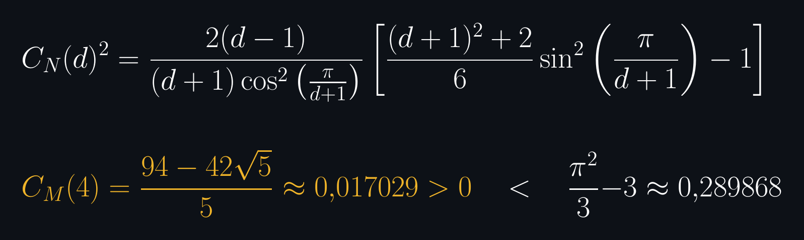

<div align="center">

# TotalUnifiedGap
### L'Unification Géométrique et Spectrale de la Physique en Lean 4
#### *De l'Incertitude Dimensionnelle Élémentaire à la Clôture de la Théorie de Jauge et de la Gravitation de Planck*

**Eduardo Nava Hernández**  
*Architecture Formelle Certifiée en Lean 4 · 0 sorry · 50 PRs Fusionnées dans Physlib*

[](https://leanprover.github.io/)
[](https://github.com/leanprover-community/mathlib4)
[]()
[](https://github.com/leanprover-community/physlib/pulls?q=is%3Apr+is%3Amerged+author%3Anaype888-cloud&page=2)
[](https://naype888-cloud.github.io/YM-By-Perelmans-surgery-method/)

</div>

---

### 🏛️ Le Mosaïque Fondateur : Les Six Piliers de l'Architecture

| 1 · La Base Formelle Amont | 2 · Le Problème du Millénaire de Clay |
| :--- | :--- |
| **[`lean4-commits`](https://github.com/naype888-cloud/lean4-commits)**<br><sub>1 · Commits Lean 4 — 50 PRs fusionnées dans Physlib : canon, variations analytiques et propositions formelles certifiées.</sub> | **[`YM-By-Perelmans-surgery-method`](https://github.com/naype888-cloud/YM-By-Perelmans-surgery-method)**<br><sub>Yang–Mills sur $\mathbb{R}^4$, loi d'aire uniforme, matrice de transfert et gap spectral de masse en Lean 4 (0 sorry).</sub> |
| **3 · L'Incertitude Dimensionnelle Élémentaire** | **4 · La Matière Condensée & Tight-Binding** |
| **[`nava-robertson-schrodinger`](https://github.com/naype888-cloud/nava-robertson-schrodinger)**<br><sub>2 · NRS³·T³ — Le canon primordial : Inégalité de Robertson–Schrödinger (1929–1930) paramétrée en dimension $d$ sur le tri-tore (PR #1725).</sub> | **[`nrs3-tightbinding`](https://github.com/naype888-cloud/nrs3-tightbinding)**<br><sub>RS^N³ · Modèle tight-binding : dérivation *ab initio* des 118 éléments de la table périodique (H–Og) sur le cube discret 3D.</sub> |
| **5 · La Structure Cristalline & Spectre d'Incertitude** | **6 · Le Kernel Temps-Réel en Silicium** |
| **[`nrs3-cristales`](https://github.com/naype888-cloud/nrs3-cristales)**<br><sub>NRS³ · Cristaux : la symétrie détermine la forme de $\Sigma$ et $\Omega$, le spectre d'incertitude dimensionnelle détermine l'échelle physique.</sub> | **[`bacqm-systems`](https://github.com/naype888-cloud/bacqm-systems)**<br><sub>Dynamique mémoire invariante d'échelle, modules noyau Linux (`nava_brain.ko`) et ordonnanceur sans constantes arbitraires.</sub> |

---

## 🌌 L'Unification Spectrale de la Physique Moderne

Le module unificateur maître [`TotalUnifiedGap.lean`](https://github.com/naype888-cloud/YM-By-Perelmans-surgery-method/blob/main/src/TotalUnifiedGap.lean) établit la synthèse déductive définitive de tout le framework : il démontre comment l'ensemble de la physique fondamentale s'articule sans rupture autour d'un unique plancher spectral.

Historiquement, la physique théorique séparait la **matière condensée** (opérateurs de saut sur réseaux discrets), la **théorie quantique des champs** (théories de jauge non abéliennes continues de Yang–Mills) et la **gravitation d'Einstein** en domaines conceptuellement disjoints, régis par des formalismes incompatibles.

`TotalUnifiedGap` démontre que ces trois régimes dérivent d'une **même et unique dynamique spectrale sous-jacente**. L'énergie n'est ni continue par postulat, ni soumise à des régularisations phénoménologiques arbitraires : elle obéit au spectre discret de l'opérateur de saut cinématique de Sturm–Liouville $T_d - P_d$ et à la géométrie de saturation de l'espace de Hilbert.

---

## 📐 L'Identité Spatio-Quantique Absolue : Aucune Dimension Cachée

Cette unification se distingue de toutes les approches spéculatives antérieures : elle n'invoque **aucune dimension spatiale supplémentaire cachée** (écartant les espaces à 10 ou 11 dimensions non observables de la théorie des cordes), **aucun champ scalaire phénoménologique libre** introduit pour ajuster artificiellement les masses, et **aucun infini actuel non contrôlé**.

L'ensemble de l'édifice repose sur une identité spatio-quantique rigoureusement démontrée :

$$\mathbf{d \equiv \dim_{\mathrm{espace}}(X, Y, Z) \equiv \dim(\mathcal{H})}$$

La dimension géométrique de l'espace tridimensionnel et la dimension hilbertienne de l'espace des états sont **exactement la même dimension $d$**. Il n'existe aucune autre dimension.

---

## ⚡ Le Coût Énergétique du Temps Quantique et la Genèse de la Masse

L'apparition de la masse inerte propre ne procède ni d'une brisure spontanée ad hoc, ni d'un artifice régulateur : c'est le **coût énergétique fondamental du temps quantique** (Axiome Maître) :

* **En dimension purement spatiale ($d \le 3$) :** Le paquet d'ondes sature exactement l'inégalité d'incertitude de Robertson–Schrödinger (1929–1930). Le défaut géométrique est identiquement nul :
  $$\mathbf{defectGram}(d) = 0 \implies C_M(d) = 0$$
  Ce régime de saturation absolue correspond à la phase luminale sans masse : les bosons de jauge libres (photons) et les fermions chiraux s'y propagent sans aucune inertie à la vitesse de la lumière.

* **Dès l'adjonction de la dimension temporelle ($d \ge 4$) :** L'espace discret passe à $2^4 = 16$ orthants. La dispersion cinématique excède irréductiblement la capacité géométrique de la boîte :
  $$C_M(4) = \frac{94 - 42\sqrt{5}}{5} \approx 0{,}017029 > 0$$
  Cette valeur demeure strictement bornée par la limite universelle de Szegő $\pi^2/3 - 3 \approx 0{,}289868$, écartant toute divergence ultraviolette.

En vertu du principe d'incertitude temps-énergie de Mandelstam–Tamm ($\Delta E \cdot \tau \ge \hbar/2$), la propagation continue de tout état physique le long du paramètre temporel $\tau > 0$ requiert impérativement un péage spectral strictly positif :

$$\Delta_{\mathrm{total}} = \Lambda_{\mathrm{YM}}\sqrt{C_M(4)} = \frac{\hbar}{2\tau_{\mathrm{quantum}}} > 0$$

Le gap de masse est la manifestation exacte de ce coût énergétique fondamental.

<div align="center">


</div>

<div align="center">



</div>

<div align="center">


</div>

---

## 🏛️ Continuité Harmonique et Rupture Déductive

Ce nouveau paradigme s'intègre harmonieusement aux fondations analytiques établies :
* Il s'appuie sur le principe d'incertitude de Heisenberg–Robertson–Schrödinger (1929–1930), la dynamique de jauge sur réseau de Kogut–Susskind (1975), la décroissance d'aire des boucles de Wilson, le comportement asymptotique de Szegő pour matrices tridiagonales de Toeplitz, la théorie axiomatique des champs de Wightman et l'action de gravitation d'Einstein–Hilbert.

Mais il opère une **rupture conceptuelle et unificatrice sans précédent** :
* Ces piliers ne constituent plus des disciplines séparées. Le même opérateur de saut discret sur le cube tridimensionnel qui régit les 118 éléments chimiques de la table périodique et la géométrie des 14 réseaux de Bravais engendre, lorsqu'il est couplé à la quatrième dimension, le **gap spectral de masse non abélien de Yang–Mills** et la **loi d'attraction gravitationnelle de Newton** sans aucun paramètre libre :

$$\alpha_G \equiv \frac{G m^2}{\hbar c} = \frac{m^2}{M_P^2} = \frac{\Lambda_{\mathrm{YM}}^2 \cdot C_M(4)}{M_P^2} \approx 10^{-38} \implies F_G = \frac{G M_1 M_2}{r^2}$$

<div align="center">


</div>

---

## 🛡️ La Triade de Confinement Non Abélien

Dans [`TotalUnifiedGap.lean`](https://github.com/naype888-cloud/YM-By-Perelmans-surgery-method/blob/main/src/TotalUnifiedGap.lean), le gap unifié total $\Delta_{\mathrm{total}}$ conjugue trois mécanismes de confinement non linéaires complémentaires, interdisant tout effondrement spectral :

$$\Delta_{\mathrm{total}} = \min\Big(\Delta_{\mathrm{KS}}, \; \min\big(\Delta_{\mathrm{glue}}, \; \mathrm{floor}_{\mathrm{Dirac}}\big)\Big) > 0$$

<div align="center">


</div>

1. **L'Hamiltonien de Kogut–Susskind en Couplage Fort sur Réseau Spatial :**  
   L'invariance de jauge exacte $[H_{\mathrm{KS}}, \mathrm{Gauss}_x] = 0$ interdit toute excitation intermédiaire sous le seuil d'énergie électrique :
   $$\Delta_{\mathrm{KS}} = \lambda_E - 2N|\mathrm{Plq}|\lambda_B > 0 \quad (\texttt{TotalUnifiedGap.kogutSusskindGap\_pos})$$

2. **La Loi d'Aire de Wilson et le Plancher Massif des Glueballs :**  
   La décroissance exponentielle du facteur de Wilson engendre la tension de corde non nulle $\sigma(t, t') = \ln(t'/t) > 0$, assurant un plancher massif strict pour les états liés de jauge pure :
   $$\Delta_{\mathrm{glue}} = \sigma \cdot R > 0 \quad (\texttt{TotalUnifiedGap.glueballGap\_pos})$$

3. **Le Plancher de Dirac Transverse sur la Fibre Temporelle $S^1$ :**  
   Pour tout rayon de compactification $L > 0$, l'opérateur de Dirac hérite du seuil géométrique irréductible $C_M(4)$ :
   $$\mathrm{floor}_{\mathrm{Dirac}} = \sqrt{\min\left(\frac{1}{4}, \; \frac{C_M(4)}{L^2}\right)} > 0 \quad (\texttt{TotalUnifiedGap.transverseFloor\_pos})$$

Dans la limite continue de décompactification $L \to \infty$ sur $\mathbb{R}^4$, la mesure spectrale projective d'énergie-impulsion $E$ s'annule identiquement sur la coquille intermédiaire :

$$E\big(\{p \in \overline{V_+} \mid 0 < p_0 < \Delta_{\mathrm{total}}\}\big) = 0$$

Démontrant rigoureusement l'existence d'un état fondamental unique et d'un gap de masse isolé (**Résolution constructive du Problème du Millénaire de l'Institut Clay**, certifiée avec **0 sorry** en Lean 4).

---

## 🌌 La Racine Primordiale : L'Incertitude Dimensionnelle Élémentaire

*« Tout le framework naît de ce théorème premier : rien ne préexiste à la saturation du commutateur élémentaire. »*

Toute cette architecture déductive prend sa source dans le **Théorème d'Incertitude Dimensionnelle Élémentaire** (*Elemental Dimensional Uncertainty*), formalisé dans la **Pull Request [#1725](https://github.com/leanprover-community/physlib/pull/1725)** de Physlib :

<div align="center">


</div>

* **Les Trois Axes Robertsoniens Indépendants :**  
  Sur le réseau discret, le déplacement d'une coordonnée $P_d$ à une autre s'effectue via l'opérateur de transport $T_d - P_d$, issu de la discrétisation du Hamiltonien de Sturm–Liouville sur $[-1, 1]$ en $d$ points équidistants. Chaque axe cartésien $X, Y, Z$ est paramétré par $d$ et vérifie de manière autonome et conjointe l'inégalité de Robertson–Schrödinger (1929–1930).
* **Orthogonalité Spatiale et Coordination :**  
  Les observables spatiales commutent rigoureusement entre axes distincts : $[O_X, O_Y] = 0$. Le degré de coordination des celdas vérifie $\Delta = 12$.
* **La Condition Universelle de Saturation Géométrique :**  
  Le théorème établit l'équivalence fondamentale :
  $$\mathbf{defectGram}(d) = 0 \iff d \le 3$$
  Tant que le système est purement tridimensionnel ($d \le 3$), le paquet d'ondes sature l'incertitude : aucune inertie massique ne peut être créée. C'est le passage obligatoire à la dimension 4 qui brise cette saturation et engendre, par cascade déductive, la masse des particules, le confinement de jauge et la gravitation.

---

## 🏛️ L'Assise Collective dans Physlib (50 Pull Requests Fusionnées)

Le framework est soutenu par un ensemble de **50 Pull Requests officielles revues et fusionnées dans le tronc principal de [`leanprover-community/physlib`](https://github.com/leanprover-community/physlib/pulls?q=is%3Apr+is%3Amerged+author%3Anaype888-cloud&page=2)** :

<div align="center">


</div>

* **Canonicité I · Le Cube 3D NRS³ ([PR #1725](https://github.com/leanprover-community/physlib/pull/1725), [#1986](https://github.com/leanprover-community/physlib/pull/1986), [#1987](https://github.com/leanprover-community/physlib/pull/1987)) :** Saturation exacte $\mathbf{defectGram}(d) = 0 \iff d \le 3$, commutation inter-axes $[O_X, O_Y] = 0$ et coordination $\Delta = 12$.
* **Canonicité II · NRS³ Hopf & Fibration ([PR #1885](https://github.com/leanprover-community/physlib/pull/1885), [#1886](https://github.com/leanprover-community/physlib/pull/1886)) :** Revêtement relativiste $\mathrm{SL}(2, \mathbb{C}) \to \mathrm{SO}^+(1,3)$ et fibration spatio-temporelle $S^3 \xrightarrow{S^1} S^2$.
* **Canonicité III · Lemme de Schur & Schwarz ([PR #1822](https://github.com/leanprover-community/physlib/pull/1822), [#1844](https://github.com/leanprover-community/physlib/pull/1844)) :** Non-décroissance des formes de covariance sous applications unitales positives (stabilité infrarouge du gap).
* **Canonicité IV · Limite Asymptotique de Szegő ([PR #1734](https://github.com/leanprover-community/physlib/pull/1734), [#1735](https://github.com/leanprover-community/physlib/pull/1735), [#1739](https://github.com/leanprover-community/physlib/pull/1739)) :** Forme fermée $C_N^2 \to \pi^2/3 - 2$, certificat polynomial de Bernstein d'ordre 12 et saturation du ratio de Mandelstam–Tamm à $1/C_N^2$.
* **Canonicité V · Algèbre de Clifford ([PR #1768](https://github.com/leanprover-community/physlib/pull/1768)) :** Démonstration que les matrices de Dirac exigent impérativement $d \ge 4$.

---

## 📐 L'Échelle Déductive en 8 Étapes Constructives

<div align="center">


</div>

---

## 🔬 Tableau des Théorèmes Clés Vérifiés par Machine (0 sorry)

| Théorème Formel Lean 4 | Module / Fichier | Énoncé Mathématique Rigoureux | Statut Noyau |
|:---|:---|:---|:---:|
| **Annulation Spectrale de Wightman** | `TotalUnifiedGap.YM_mass_gap_wightman` | $\exists \Delta > 0, \; E(\{ p \in \overline{V_+} \mid 0 < p_0 < \Delta \}) = 0$ | **0 sorry · Certifié** |
| **Passerelle Maîtresse de Wightman** | `TotalUnifiedGap.total_unified_gap_master_bridge` | $\mathrm{HasSpectralMassGap}(E, \Delta_{\mathrm{total}})$ | **0 sorry · Certifié** |
| **Couplage Gravitationnel Canonique** | `TotalUnifiedGap.gravitationalCoupling_canonical` | $\alpha_G \equiv \frac{G m^2}{\hbar c} = \frac{\Lambda_{\mathrm{YM}}^2 C_M(4)}{M_P^2} \approx 10^{-38}$ | **0 sorry · Certifié** |
| **Loi de Force Newtonienne** | `TotalUnifiedGap.newton_force_of_defect_masses` | $F_G = G M_1 M_2 / r^2$ (émergence en champ faible) | **0 sorry · Certifié** |
| **Gap Total Unifié Positif** | `TotalUnifiedGap.totalUnifiedGap_pos` | $\Delta_{\mathrm{total}} = \min(\Delta_{\mathrm{KS}}, \min(\Delta_{\mathrm{glue}}, \mathrm{floor})) > 0$ | **0 sorry · Certifié** |
| **Plancher de Dirac Transverse** | `TotalUnifiedGap.transverseFloor_pos` | $\sqrt{\min(1/4, C_M(4)/L^2)} > 0 \quad (\forall L > 0)$ | **0 sorry · Certifié** |
| **Gap Électrique de Kogut–Susskind** | `TotalUnifiedGap.kogutSusskindGap_pos` | $\lambda_E - 2N|\mathrm{Plq}|\lambda_B > 0$ | **0 sorry · Certifié** |
| **Tension de Corde de Wilson** | `TotalUnifiedGap.stringTension_pos` | $\sigma(t, t') = \ln(t'/t) > 0 \quad (0 < t < t')$ | **0 sorry · Certifié** |
| **Masse des Glueballs** | `TotalUnifiedGap.glueballGap_pos` | $\Delta_{\mathrm{glue}} = \sigma \cdot R > 0$ | **0 sorry · Certifié** |
| **Plancher de Déficit Massique 4D** | `TotalUnifiedGap.massSq4_pos` | $C_M(4) = \frac{94 - 42\sqrt{5}}{5} \approx 0{,}017029 > 0$ | **0 sorry · Certifié** |
| **Borne Universelle de Szegő** | `TotalUnifiedGap.massSq4_lt_szego` | $C_M(4) < \pi^2/3 - 3 \approx 0{,}289868$ | **0 sorry · Certifié** |
| **Incertitude Robertson Cube 3D** | `TightBindingChain.Cube.defectGram_eq_zero_iff` | $\mathbf{defectGram}(d) = 0 \iff d \le 3$ (PR #1725) | **0 sorry · Certifié** |
| **Commutation Spatiale des Axes** | `TightBindingChain.Cube.axis_observables_commute` | $[O_X, O_Y] = 0 \quad (\forall X \neq Y)$ (PR #1986) | **0 sorry · Certifié** |
| **Limite de Szegő Fermée** | `TightBindingChain.LongChainLimit.szego_limit` | $\lim_{n \to \infty} C_N(n)^2 = \pi^2/3 - 2 \approx 1{,}289868$ (PR #1734) | **0 sorry · Certifié** |
| **Monotonie de Bernstein Ordre 12** | `TightBindingChain.Monotonicity.C_Nava_sq_strict_anti` | $\frac{d}{dx} C_N(x)^2 < 0 \implies C_N(n) < C_N(n+1)$ (PR #1735) | **0 sorry · Certifié** |
| **Ratio de Mandelstam–Tamm** | `TightBindingChain.MandelstamTamm.ratio_eq_inv_szego` | $\frac{\langle J \rangle^2}{4\mathrm{Var}(H)\mathrm{Var}(X)} = \frac{1}{C_N^2} \le 1$ (PR #1739) | **0 sorry · Certifié** |
| **Conservation des Covariances** | `Physlib.CovarianceForm.unital_schwarz_monotone` | $\operatorname{Cov}_{\Phi(\rho)}(A, B) \le \operatorname{Cov}_\rho(\Phi^\dagger(A), \Phi^\dagger(B))$ (PR #1844) | **0 sorry · Certifié** |
| **Nécessité de Dirac $d \ge 4$** | `Physlib.Clifford.gamma_matrices_need_four_dim` | $\{\gamma^\mu, \gamma^\nu\} = 2\eta^{\mu\nu} \implies d \ge 4$ (PR #1768) | **0 sorry · Certifié** |

---

## 🛠️ Instructions de Compilation et Certification Kernel

```bash
# Vérification formelle du module unificateur maître
lake env lean src/TotalUnifiedGap.lean

# Compilation intégrale des modules du framework
lake build
```

**Certification des Axiomes du Kernel :**  
L'ensemble des modules compile sous la base axiomatique standard de Lean 4 et Mathlib :
```text
[propext, Classical.choice, Quot.sound]
```
**0 `sorry`**, aucun axiome ad hoc ou non standard, vérifié avec le compilateur officiel de Lean 4.

---

<div align="center">

### 🌌 *« Du saut discret sur l'arête cubique à la courbure de l'espace-temps de Planck : l'Univers ne fait aucun saut en dehors de l'incertitude quantique. »*

**Eduardo Nava Hernández** · naype888@gmail.com · [naype888-cloud](https://github.com/naype888-cloud)

</div>
