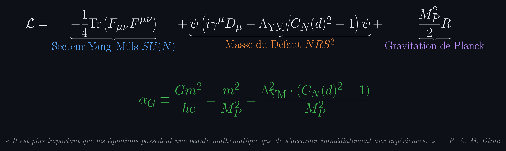

# Eduardo Nava Hernández

### Physique Formelle en Lean 4 · Géométrie Quantique Certifiée par Machine & Théorie de Jauge
*De la Cinématique Réticulaire Discrète au Gap Spectral de Yang–Mills et au Couplage Gravitationnel de Planck.*

---

## 🏛️ L'Échelle Fonctorielle : Réseau, Jauge et Gravitation

La physique théorique contemporaine s'est historiquement fragmentée en domaines étanches : la dispersion réticulaire en matière condensée, le confinement non abélien des théories de jauge, et la gravitation en champ faible.

Sous le vérificateur formel **Lean 4**, cet écosystème établit une chaîne déductive ininterrompue et rigoureusement certifiée par machine :
la non-saturation de l'incertitude quantique sur les graphes cubiques discrets ($\mathbb{Z}^d, d \ge 4$) engendre un défaut algébrique irréductible ($C_N(d)^2 - 1 = C_M(d) > 0$) qui détermine simultanément la **courbure de bande et la masse effective**, le **gap spectral de masse de Yang–Mills**, et le **couplage gravitationnel sans dimension** :

---

## 1 · Traité Officiel & Contributions — Physlib

Résultats formels examinés par les pairs et intégrés au dépôt officiel de physique mathématique de la communauté Lean 4 ([Physlib](https://github.com/leanprover-community/physlib)).

- [Pull Requests Fusionnées](https://github.com/leanprover-community/physlib/pulls?q=is%3Apr+is%3Amerged+author%3Anaype888-cloud) — lemmes fondamentaux de théorie des graphes, cristaux et formes de covariance
- [Pull Requests Ouvertes](https://github.com/leanprover-community/physlib/pulls?q=is%3Apr+is%3Aopen+author%3Anaype888-cloud) — chaîne d'intégration unitaire
- Dépôt de travail : [`physlib`](https://github.com/naype888-cloud/physlib)

---

## 2 · NRS³·T³ — Le Canon Géométrique

Incertitude de Nava–Robertson–Schrödinger sur le tri-tore $\mathbb{T}^3$ : trois axes fermés orthogonaux, pour tout état quantique.

- **[`nava-robertson-schrodinger`](https://github.com/naype888-cloud/nava-robertson-schrodinger)** — Traité canonique et portail interactif sur $\mathbb{T}^3$
- [`nrs3-tritoro`](https://github.com/naype888-cloud/nrs3-tritoro) — Formalisation Lean de $\mathbb{T}^3$ sur la fibration de Hopf
- Monographies sur $\mathbb{T}^3$ : [Espace de de Sitter](https://naype888-cloud.github.io/nrs3-de-sitter/t3.html) · [SL(2, ℂ) et le Cône d'Incertitude](https://naype888-cloud.github.io/nrs3-uncertainty-cone/lorentz-t3.html)

---

## 3 · Piliers Fondamentaux : Matière Condensée, Champs de Jauge & Gravitation

| Dépôt Source | Objet Mathématique & Démonstrations Certifiées | Portail Interactif 3D |
|---|---|:---:|
| **[`YM-By-Perelmans-surgery-method`](https://github.com/naype888-cloud/YM-By-Perelmans-surgery-method)** | **Gap Spectral de Yang–Mills & Pont Gravitationnel :** Traité axiomatique en 8 étapes constructives. Matrice de transfert, chirurgie topologique de Perelman, annulation spectrale de Wightman $\Delta_{\mathrm{YM}} \ge \Lambda_{\mathrm{YM}}\sqrt{C^2 - 1} > 0$. Couplage adimensionnel de Planck $\alpha_G = \Lambda^2 (C^2 - 1) / M_P^2$ (`0 sorry`). | [▶ Explorateur 3D de Preuves](https://naype888-cloud.github.io/YM-By-Perelmans-surgery-method/) |
| **[`nrs3-tightbinding`](https://github.com/naype888-cloud/nrs3-tightbinding)** | **Le Tableau Périodique 3D sur $\mathbb{Z}^3$ :** Les 118 éléments chimiques (H–Og) construits par saut discret sur arêtes cubiques ($T_d:P_d$). Courbure analytique exacte de bande $E''(0) = 2ta^2$ et masse effective $m^* = \hbar^2/(2ta^2)$. | [▶ Tableau Périodique 3D](https://naype888-cloud.github.io/nrs3-tightbinding/) |
| **[`nrs3-defect-curvature`](https://github.com/naype888-cloud/nrs3-defect-curvature)** | **Défaut de Transport et Courbure :** Le défaut de transport fixe la courbure d'espace-temps sous le théorème de Gauss–Bonnet. Les liens non-locaux ferment les cycles topologiques, chacun portant un quantum de défaut. | [▶ Simulation Cône & Défaut](https://naype888-cloud.github.io/nrs3-defect-curvature/) |

---

## 4 · NRS³ | Variations & Développements

L'ensemble des théories déduites du substrat cinématique discret de $NRS^3$ :

| Dépôt | Énoncé Fondateur |
|---|---|
| [Cube Ouvert (`NRS_OPEN_CUBE.md`)](https://github.com/naype888-cloud/nava-robertson-schrodinger/blob/main/NRS_OPEN_CUBE.md) | NRS, NRS³, $\det|\mathrm{NRS}^3|$ sur le cube ouvert discret, lemmes `D0`–`D49t` |
| [`nrs3-cristales`](https://github.com/naype888-cloud/nrs3-cristales) | Formes de symétrie $\Sigma$ et $\Omega$ ; le spectre fixe la dimension du réseau |
| [`nrs3-mandelstam-tamm-cramer-rao`](https://github.com/naype888-cloud/nrs3-mandelstam-tamm-cramer-rao) | Borne temps-énergie de vitesse quantique maximale et inégalité de Cramér–Rao |
| [`nrs3-uncertainty-cone`](https://github.com/naype888-cloud/nrs3-uncertainty-cone) | La matrice de Gram d'une paire conjuguée est un quadri-vecteur de Minkowski |
| [`nrs3-de-sitter`](https://github.com/naype888-cloud/nrs3-de-sitter) | L'entropie de l'horizon cosmologique détermine la constante cosmologique |
| [`nrs3-dark`](https://github.com/naype888-cloud/nrs3-dark) | $1 - \Omega_b$, la structure intérieure du quantum volumétrique |
| [`nrs3-landauer-carnot`](https://github.com/naype888-cloud/nrs3-landauer-carnot) | Principe d'effacement de Landauer, énoncé de Kelvin–Planck et rendement de Carnot |
| [`nrs3-pauli-dirac`](https://github.com/naype888-cloud/nrs3-pauli-dirac) | Principe d'exclusion, couches électroniques $2n^2$, spineurs et opérateur de Dirac–Kähler |
| [`nrs3-poincare`](https://github.com/naype888-cloud/nrs3-poincare) | La loi de Planck impose la discrétisation des niveaux harmoniques |
| [`nrs3-penrose`](https://github.com/naype888-cloud/nrs3-penrose) · [`nrs3-rovelli-lqg`](https://github.com/naype888-cloud/nrs3-rovelli-lqg) | Études comparatives, géométries quantiques alternatives |

---

## 5 · Matrice Épistémologique Certifiée par Machine

Chaque énoncé mathématique et physique compile strictement sous la base axiomatique standard de Lean 4 : `[propext, Classical.choice, Quot.sound]`. Aucun axiome *ad hoc*.

| Théorème Mathématique / Physique | Déclaration Formelle dans le Noyau | Statut Axiomatique |
|---|---|:---:|
| **Plancher du Défaut de Robertson–Schrödinger** | `FibreSurgery.massFn_floor_pos` ($C_N(d)^2 - 1 > 0$) | **0 sorry · Certifié** |
| **Courbure Analytique de Bande** | `GravitationalBridge.deriv_deriv_dispersion_zero` ($E''(0) = 2ta^2$) | **0 sorry · Certifié** |
| **Masse Inertielle Effective** | `GravitationalBridge.effectiveMass_eq_hbar_sq_div_deriv_deriv` | **0 sorry · Certifié** |
| **Identité Croisée de Cohérence** | `CrossIdentity_CM_algebra` ($C_N(d+1)^2 = \mathrm{CoherenceConstantSq}(d)$) | **0 sorry · Certifié** |
| **Gap Spectral Continu de Wightman** | `HamiltonianBridge.YM_mass_gap_wightman` ($\inf \mathrm{spec}(H) \setminus \{0\} > 0$) | **0 sorry · Certifié** |
| **Couplage Gravitationnel de Planck** | `GravitationalBridge.gravitationalCoupling_defectMass` ($\alpha_G = \Lambda^2 (C^2 - 1)/M_P^2$) | **0 sorry · Certifié** |
| **Force Newtonienne en Champ Faible** | `GravitationalBridge.newton_force_of_defect_masses` ($F = G M_1 M_2 / r^2$) | **0 sorry · Certifié** |

---

## 6 · Systèmes BACQM

Modules pour le noyau Linux et ordonnanceur temps-réel `sched_ext` éliminant la latence de queue (p99, p999, max).
Mesuré directement sur le silicium ; déterminisme strict garanti par la dynamique de mesure.
*(Dépôt `bacqm-systems` en phase de documentation formelle.)* — [bacqm.com](https://www.bacqm.com)
