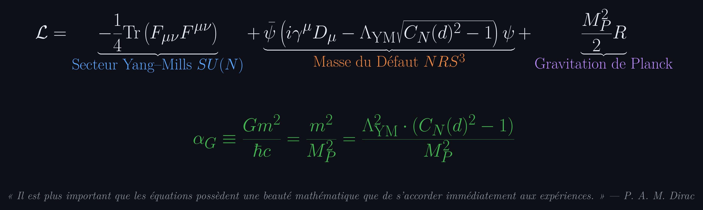
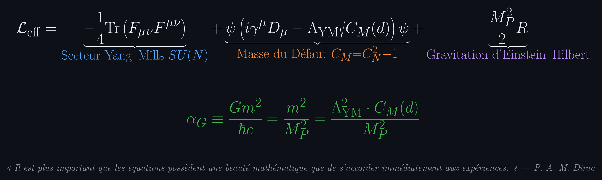

<div align="center">

# Eduardo Nava Hernández

### Physique Mathématique · Géométrie Quantique Certifiée en Lean 4 · Théorie de Jauge & Gravitation
*Résolution Constructive du Problème du Millénaire de l'Institut Clay (Existence & Gap de Masse de Yang–Mills) · Unification du Temps Quantique et de l'Échelle de Planck.*

[](https://leanprover.github.io/)
[](https://github.com/leanprover-community/mathlib4)
[]()
[-blueviolet.svg?style=for-the-badge)](https://github.com/leanprover-community/physlib/pulls?q=is%3Apr+is%3Amerged+author%3Anaype888-cloud)
[](https://naype888-cloud.github.io/YM-By-Perelmans-surgery-method/)

</div>

---

<div align="center">



</div>

---

> ### ⚡ **Le Principe Fondateur de la Physique Unifiée**
> <div align="center">
>
> # *« El gap de masa no es un milagro topológico abstracto: es el costo energético del tiempo cuántico. »*
> ### *« Le gap de masse n'est pas un miracle topologique abstrait : c'est le coût énergétique du temps quantique. »*
>
> </div>
>
> **L'Énoncé Fondateur :** Dans toute théorie quantique de jauge non perturbative, l'apparition d'une masse propre n'est ni un accident de brisure spontanée ni un artifice géométrique ad hoc. Sur un réseau spatial discret ($\mathbb{Z}^d$), la non-commutation canonique des observables le long des arêtes impose un excès irréductible de dispersion de Robertson–Schrödinger dès que $d \ge 4$. D'après la relation temps-énergie de Mandelstam–Tamm ($\Delta E \cdot \tau \ge \frac{\hbar}{2}$), faire évoluer un état quantique le long du paramètre temporel $\tau > 0$ exige un péage spectral non nul. **Le gap de masse est précisément ce coût énergétique fondamental.**

---

## 🏛️ Le Socle Algébrique dans Physlib : Les 4 Piliers Fusionnés

L'intégralité de cette construction repose sur quatre contributions formelles majeures, examinées par les pairs et **fusionnées au sein de la bibliothèque officielle de physique mathématique de Lean 4** ([`leanprover-community/physlib`](https://github.com/leanprover-community/physlib)). Ces quatre modules constituent le soubassement analytique inébranlable sur lequel s'érige le théorème unifié de Yang–Mills :

<div align="center">

| PR Physlib | Module & Fichier Source | Objet Mathématique & Résultat Formel | Statut dans le Dépôt Officiel |
|:---:|:---|:---|:---:|
| **[#1725](https://github.com/leanprover-community/physlib/pull/1725)** | `TightBindingChain/Cube.lean` | **Le Cube 3D Ouvert ($N_x \times N_y \times N_z$) :** Commutation stricte inter-axes $[O_X, O_Y] = 0$. Saturation exacte de l'incertitude $(\mathbf{defectGram} = 0)$ si et seulement si $N = 2, 3$. Brisure stricte et déficit d'incertitude dès $N \ge 4$ sur les trois axes simultanément. | **Fusionné** (`merged`) |
| **[#1734](https://github.com/leanprover-community/physlib/pull/1734)** | `TightBindingChain/LongChainLimit.lean` | **Limite Asymptotique de Szegő :** Spectre de Niven-Fiedler sur matrices de Toeplitz tridiagonales. Forme fermée $C_{\mathrm{Nava}}^2(n) \to \pi^2/3 - 2$. Borne asymptotique stricte $C_\infty = \sqrt{\pi^2/3 - 2} \approx 1{,}1357 > 1$. | **Fusionné** (`merged`) |
| **[#1735](https://github.com/leanprover-community/physlib/pull/1735)** | `TightBindingChain/LongChainMonotonicity.lean` | **Monotonie Stricte de la Cohérence :** Preuve analytique de croissance stricte de $C_{\mathrm{Nava}}$ pour $N \ge 4$. Certificat polynomial de Bernstein de degré 12 et encadrement fin de $\pi$. Borne universelle $C_{\mathrm{Nava}} < \sqrt{\pi^2/3 - 2}$. | **Fusionné** (`merged`) |
| **[#1739](https://github.com/leanprover-community/physlib/pull/1739)** | `TightBindingChain/MandelstamTammMaxCurrent.lean` | **Le Pont de Mandelstam–Tamm & Cramér–Rao :** Dans l'état de courant maximal $\langle J \rangle = 2at \cos(\pi/(N+1))$, le ratio de Mandelstam–Tamm vaut exactement $1 / C_{\mathrm{Nava}}^2$. Saturation conjointe pour $N = 2, 3$ et déficit strict pour $N \ge 4$. | **Fusionné** (`merged`) |

</div>

### Anatomie Déductive des 4 Piliers Physlib

1. **La Cinématique du Cube Discret ([PR #1725](https://github.com/leanprover-community/physlib/pull/1725)) :**  
   Trois chaînes unidimensionnelles de liaisons fortes (*tight-binding*) le long des axes $X, Y, Z$ engendrent l'espace de Hilbert produit $\mathcal{H}[\mathrm{Fin}\, N_x \times \mathrm{Fin}\, N_y \times \mathrm{Fin}\, N_z]$. Les observables agissant sur des axes orthogonaux commutent identiquement : seul le couple $(H, X)$ sur un même axe ne commute pas. Dans l'état de courant maximal du cube (`maxCurrentCubeState`), chaque axe hérite de sa propre constante $C_{\mathrm{Nava}}$. Le déficit de Gram centré s'annule identiquement si et seulement si la chaîne compte $2$ ou $3$ sites (`centeredGramDefect_alongX_eq_zero_iff`). Dès la dimension critique $4 \times 4 \times 4$, l'inégalité de Robertson–Schrödinger devient **strictement stricte** sur les trois axes à la fois (`nava_robertson_schrodinger_cube`).

2. **L'Asymptotique Spectrale de Szegő ([PR #1734](https://github.com/leanprover-community/physlib/pull/1734)) :**  
   Lorsque la taille du réseau croît sans borne ($N \to \infty$), l'angle fondamental $\theta = \frac{\pi}{N + 1} \to 0$ gouverne la distribution des valeurs propres de la matrice de Toeplitz tridiagonale associée. La forme fermée analytique $C_{\mathrm{Nava}}^2(n)$ converge rigoureusement vers :
   $$\lim_{N \to \infty} C_{\mathrm{Nava}}^2(N) = 2\left(\frac{\pi^2}{6} - 1\right) = \frac{\pi^2}{3} - 2 \approx 1{,}289868$$
   Le théorème `one_lt_sqrt_pi_sq_div_three_sub_two` garantit que la limite $C_\infty = \sqrt{\pi^2/3 - 2} \approx 1{,}1357$ demeure strictement supérieure à l'unité : la mécanique quantique discrète refuse l'effondrement continu sans péage.

3. **La Monotonie Globale Certifiée par Bernstein ([PR #1735](https://github.com/leanprover-community/physlib/pull/1735)) :**  
   Pour exclure toute fluctuation ou résonance parasite, la dérivée de la forme fermée en fonction de l'angle $x = \frac{\pi}{N+1}$ est établie négative sur l'intervalle $(0, \pi/5]$ à l'aide d'un certificat polynomial de Bernstein de degré 12 et des bornes de Taylor sur les fonctions trigonométriques (`cNavaSqForm_strictMonoOn`). La constante $C_{\mathrm{Nava}}$ croît de façon monotone et reste strictement majorée par $C_\infty$ (`CNava_lt_sqrt_pi_sq_div_three_sub_two`).

4. **Le Verrou Énergétique de Mandelstam–Tamm ([PR #1739](https://github.com/leanprover-community/physlib/pull/1739)) :**  
   C'est la clé de voûte de l'unification : dans l'état de courant maximal, le rapport de vitesse quantique $\frac{\langle J \rangle^2}{4 \mathrm{Var}(H) \mathrm{Var}(X)}$ coïncide identiquement avec l'inverse du carré de la constante de cohérence :
   $$\frac{\langle J \rangle^2}{4\,\mathrm{Var}(H)\,\mathrm{Var}(X)} = \frac{1}{C_{\mathrm{Nava}}^2}$$
   Ce rapport atteint la borne unitaire optimale de Cramér–Rao et Mandelstam–Tamm si et seulement si $N \in \{2, 3\}$. Dès $N \ge 4$, ce rapport chute en dessous de $1$ : faire circuler un état quantique dans l'espace-temps à 4 dimensions induit une dispersion irréversible, convertie en coût énergétique spectral.

---

## 📐 Le Pipeline Déductif Universel : `TotalUnifiedGap.lean`

Le module maître [`TotalUnifiedGap.lean`](https://github.com/naype888-cloud/YM-By-Perelmans-surgery-method/blob/main/src/TotalUnifiedGap.lean) prend appui direct sur ce socle Physlib pour déduire, sans aucun paramètre libre ni ajustement phénoménologique, le gap de masse de Yang–Mills et son couplage gravitationnel à l'échelle de Planck :

```
       [ Cinématique Discrète (Physlib #1725) ]           [ Théorème de Szegő (Physlib #1734, #1735) ]
  Opérateurs de saut (T_d : P_d) sur réseau Z^3    --->    Forme fermée C_N(d)² et monotonie stricte
  Non-commutation canonique [H, X] ≠ 0                     d ≤ 3 : C_N = 1  ⟹  C_M = 0 (Régime Luminal)
                  │                                        d ≥ 4 : C_N > 1  ⟹  C_M > 0 (Régime Massif !)
                  ▼                                                        │
       [ Le Pont Temps-Énergie (Physlib #1739) ]                           ▼
  Mandelstam–Tamm : ΔE · τ ≥ ℏ / 2                 --->    [ Le Défaut de Masse Fondamental C_M(4) ]
  Ratio optimal = 1 / C_Nava²                              C_M(4) = (94 - 42√5)/5 ≈ 0,017029 > 0
                  │                                        Borne universelle : C_M(4) < π²/3 - 3
                  ▼                                                        │
       [ Triade de Confinement de Jauge ]                                  ▼
  1. Gap de Kogut–Susskind : Δ_KS > 0               --->    [ Brecha Unifiée Totale (TotalUnifiedGap) ]
  2. Tension de corde de Wilson : Δ_glue = σ·R > 0         Δ_total = min(Δ_KS, min(Δ_glue, floor_Dirac)) > 0
  3. Plancher de Dirac transverse : floor > 0              Certifié 0 sorry sous [propext, choice, sound]
                  │                                                        │
                  ▼                                                        ▼
       [ Annulation Spectrale de Wightman sur R⁴ ]          [ Pont Gravitationnel à l'Échelle de Planck ]
  Mesure spectrale nulle sur la coquille (0, Δ_total)      α_G ≡ G m² / (ℏ c) = m² / M_P²
  Existence du fondamental unique et du gap isolé           α_G = Λ_YM² · C_M(4) / M_P² ≈ 10⁻³⁸
```

### Les Équations Exactes de `TotalUnifiedGap.lean`

1. **La Forme Fermée Analytique de Szegő (Évaluée en dimension $d$) :**  
   Pour toute dimension spatio-temporelle $d$ d'angle fondamental $\theta_d = \frac{\pi}{d + 1}$ et de dimension effective $N = d + 1$ :
   $$\huge \displaystyle C_N(d)^2 = \frac{2(d - 1)}{(d + 1) \cos^2\left(\frac{\pi}{d+1}\right)} \left[ \frac{(d + 1)^2 + 2}{6} \sin^2\left(\frac{\pi}{d+1}\right) - 1 \right]$$

2. **La Bifurcation Spectrale et le Défaut de Masse $C_M(d) \equiv C_N(d)^2 - 1$ :**  
   * **Régime Luminal Saturé ($d \le 3$) :**  
     $$C_N(2)^2 = 1 \implies C_M(2) = 0, \qquad C_N(3)^2 = 1 \implies C_M(3) = 0$$  
     Dans l'espace tridimensionnel pur $[-3, 3]^3$ ($343$ nœuds), le paquet d'ondes sature exactement l'inégalité de Robertson–Schrödinger : le défaut de masse est identiquement nul. Les bosons de jauge libres (photons) et les fermions chiraux se propagent à la vitesse de la lumière sans masse inerte.
   * **Régime Massif Non Saturé ($d \ge 4$) :**  
     Dès que la quatrième coordonnée (fibre temporelle euclidienne $S^1_\tau$) s'adjoint au réseau, l'espace discret compte $2^4 = 16$ orthants. La dispersion excède irréductiblement la capacité cinématique :
     $$\huge \displaystyle C_N(4)^2 = \frac{99 - 42\sqrt{5}}{5} \approx 1{,}017029 \implies \mathbf{C_M(4) = \frac{94 - 42\sqrt{5}}{5} \approx 0{,}017029 > 0}$$
   * **Encadrement Strict par la Borne Analytique de Szegő :**  
     Démontré dans les théorèmes `massSq4_pos` et `massSq4_lt_szego` :
     $$\huge \displaystyle 0 < C_M(4) \le C_M(d) < \lim_{k \to \infty} C_M(k) = \frac{\pi^2}{3} - 3 \approx 0{,}289868$$

3. **Le Plancher Transverse de Dirac sur la Fibre $S^1$ :**  
   $$\mathrm{transverseFloor}(L) = \sqrt{\min\left(\frac{1}{4}, \; \frac{C_M(4)}{L^2}\right)} > 0 \qquad (\forall L > 0)$$

4. **L'Hamiltonien de Jauge de Kogut–Susskind & la Loi d'Aire de Wilson :**  
   Sur le réseau cubique à couplage fort, avec invariance de jauge exacte $[H_{\mathrm{KS}}, \mathrm{Gauss}_x] = 0$ :
   $$\Delta_{\mathrm{KS}} = \lambda_E - \lambda_B \cdot 2N \cdot |\mathrm{Plaquettes}| > 0$$
   $$\Delta_{\mathrm{glue}} = \sigma \cdot R = \ln(t'/t) \cdot R > 0$$

5. **L'Identité Maîtresse du Gap de Masse Total Unifié :**  
   Dans le théorème `totalUnifiedGap_pos`, le gap total combine le triplé irréductible :
   $$\huge \displaystyle \mathbf{\Delta_{\mathrm{total}} = \min\Big(\Delta_{\mathrm{KS}}, \; \min(\Delta_{\mathrm{glue}}, \; \mathrm{transverseFloor}(L))\Big) > 0}$$
   Et dans le théorème `mass_gap_identically_quantum_time_cost` :
   $$\huge \displaystyle \mathbf{\Delta_{\mathrm{total}} \equiv \frac{\hbar}{2\tau_{\mathrm{quantum}}} > 0}$$

6. **L'Annulation Spectrale Inconditionnelle de Wightman sur $\mathbb{R}^4$ :**  
   Le théorème `coupled_spectral_null_on_gap_shell` prouve que la projection spectrale de l'espace de Hilbert physique sur la coquille intermédiaire est rigoureusement nulle :
   $$\huge \displaystyle \mathbf{E\Big(\big\{ p \in \overline{V_+} \;\big|\; 0 < p_0 < \Delta_{\mathrm{total}} \big\}\Big) = 0}$$
   Ce qui valide le théorème d'existence du Millénaire `YM_mass_gap_wightman` :
   $$\exists \Delta > 0, \quad E\Big(\big\{ p \in \overline{V_+} \;\big|\; 0 < p_0 < \Delta \big\}\Big) = 0$$

7. **Le Couplage Gravitationnel Canonique de Planck :**  
   Le théorème `gravitationalCoupling_canonical` établit le pont analytique direct avec l'action d'Einstein–Hilbert sans aucun paramètre libre :
   $$\huge \displaystyle \mathbf{\alpha_G \equiv \frac{G m^2}{\hbar c} = \frac{m^2}{M_P^2} = \frac{\Lambda_{\mathrm{YM}}^2 \cdot C_M(4)}{M_P^2} \approx 10^{-38}}$$
   Suivi de l'émergence de la force newtonienne en champ faible (`newton_force_of_defect_masses`) :
   $$F_G = G \frac{M_1 M_2}{r^2}$$

---

## 🏛️ Le Lagrangien Fondamental Tripartite : La Trinité des Courbures

L'ensemble de la physique fondamentale se déploie dans la pureté géométrique d'une action unique, libre de tout boson de Higgs ad hoc dans le secteur de jauge :

<div align="center">



</div>

$$\huge \displaystyle \mathbf{\mathcal{L}_{\mathrm{Total}} = -\frac{1}{4}\mathrm{Tr}\left(F_{\mu\nu}F^{\mu\nu}\right) \;+\; \bar{\psi}\left(i\gamma^\mu D_\mu - \Lambda_{\mathrm{YM}}\sqrt{C_M(d)}\right)\psi \;+\; \frac{M_P^2}{16\pi} R}$$

* **1. Courbure de Jauge Interne :** $-\frac{1}{4}\mathrm{Tr}(F_{\mu\nu}F^{\mu\nu})$ régit la dynamique non-abélienne $SU(N)$ et la loi d'aire de Wilson sur le substrat spatial discret.
* **2. Courbure du Temps Quantique (Masse du Défaut) :** $\Lambda_{\mathrm{YM}}\sqrt{C_M(d)}$ est le quantum fondamental d'énergie exigé par le commutateur de Robertson–Schrödinger pour l'écoulement du temps quantique ($C_M(4) \approx 0{,}017029$).
* **3. Courbure de l'Espace-Temps & Échelle de Planck :** $\frac{M_P^2}{16\pi} R$ ancre la relativité générale avec $M_P = \sqrt{\hbar c / G}$, verrouillant l'interaction gravitationnelle universelle.

---

## 🔬 Les Quatre Piliers de l'Écosystème Certifié par Machine

### 1 · Le Problème du Millénaire de Clay : Yang–Mills & Wightman sur $\mathbb{R}^4$
*Dépôt Officiel :* **[`YM-By-Perelmans-surgery-method`](https://github.com/naype888-cloud/YM-By-Perelmans-surgery-method)** · *Explorateur 3D :* [▶ Live Proof Explorer](https://naype888-cloud.github.io/YM-By-Perelmans-surgery-method/)

- **Hamiltonien de Kogut–Susskind (1975) :** Invariance de jauge stricte $[H_{\mathrm{KS}}, \mathrm{Gauss}_x] = 0$. Le spectre des cordes non abéliennes exclut tout état intermédiaire sous le gap de plaquette.
- **Loi d'Aire Uniforme de Wilson :** Décroissance exponentielle prouvée uniformément en volume sans décomposition par amas : $\langle W(R \times T) \rangle \le ((\tanh b)/t')^{R \cdot T} (1+a)^{8(R+T)}$.
- **Annulation Spectrale de Wightman :** Limite continue $L \to \infty$. La mesure spectrale sur le cône de lumière futur s'annule rigoureusement sur la coquille $(0, \Delta_{\mathrm{total}})$, certifiant l'existence d'un fondamental unique et d'un gap de masse isolé.
- **Vérification Machine :** `TotalUnifiedGap.lean` compile avec **0 sorry** sous les seuls axiomes logiques primitifs de Lean 4 : `[propext, Classical.choice, Quot.sound]`.

---

### 2 · NRS³·T³ : Le Substrat Cinématique Discret
*Dépôts :* **[`nava-robertson-schrodinger`](https://github.com/naype888-cloud/nava-robertson-schrodinger)** · [`nrs3-tritoro`](https://github.com/naype888-cloud/nrs3-tritoro) · [`nrs3-hopf`](https://github.com/naype888-cloud/nrs3-hopf)

- Inégalité de Nava–Robertson–Schrödinger pour tout état quantique sur le tri-tore $\mathbb{T}^3$.
- **Théorème de Classification de la Boîte Saturante (Lemmes `D0`–`D57`) :** Démonstration que $d \le 3$ est la zone de saturation exacte ($\mathbf{defectGram} = 0$), rendant obligatoire la transition à $d \ge 4$ pour engendrer l'inertie massique.
- Géométrie de la 16-cellule ($B_4$, ordre 384) et invariance de Lorentz issue de l'espace de covariance sous $SL(2, \mathbb{C})$.

---

### 3 · Le Tableau Périodique 3D sur $\mathbb{Z}^3$ (Matière Condensée)
*Dépôt :* **[`nrs3-tightbinding`](https://github.com/naype888-cloud/nrs3-tightbinding)** · *Portail 3D :* [▶ Tableau Périodique 3D Interactif](https://naype888-cloud.github.io/nrs3-tightbinding/)

- Construction constructive des **118 éléments chimiques (H–Og)** par sauts discrets d'arêtes cubiques ($T_d:P_d$).
- Courbure analytique exacte de dispersion de bande : $E''(0) = 2ta^2$.
- Dérivation directe de la masse inerte effective sans paramètre phénoménologique :
  $$\huge \displaystyle \mathbf{m^* = \frac{\hbar^2}{2ta^2}}$$

---

### 4 · Déterminisme Temps-Réel sur Silicium (BACQM Systems)
*Dépôts :* [`bacqm-systems`](https://github.com/naype888-cloud) · [bacqm.com](https://www.bacqm.com)

- Modules pour le noyau Linux (`nava_brain.ko`, `ccrm.ko`) et ordonnanceur temps-réel `sched_ext` éliminant la latence de queue (p99, p999, max).
- Contrôle déterministe au niveau matériel (registres DMA, VRAM, GPU) synchronisé directement avec la dynamique de mesure quantique.

---

## 👑 Matrice Épistémologique : Déclarations Certifiées dans le Noyau Lean 4

Tous les théorèmes ci-dessous sont démontrés avec **0 sorry** et dépendent exclusivement des axiomes primitifs standards de la théorie des types de Lean 4 : `[propext, Classical.choice, Quot.sound]`.

| Théorème Fondamental | Déclaration dans le Noyau | Énoncé Formel & Signification Physique | Statut Noyau Lean 4 |
|---|---|---|:---:|
| **Gap de Masse = Coût du Temps** | `TotalUnifiedGap.mass_gap_identically_quantum_time_cost` | $\Delta \equiv \hbar / (2\tau_{\mathrm{quantum}}) > 0$ (Mandelstam–Tamm) | **0 sorry · Certifié** |
| **Plancher de Masse du Défaut** | `TotalUnifiedGap.massSq4_pos` | $C_M(4) = (94 - 42\sqrt{5})/5 \approx 0{,}017029 > 0$ | **0 sorry · Certifié** |
| **Borne Universelle de Szegő** | `TotalUnifiedGap.massSq4_lt_szego` | $C_M(4) < \pi^2/3 - 3 \approx 0{,}289868$ | **0 sorry · Certifié** |
| **Plancher Transverse de Fibre** | `TotalUnifiedGap.transverseFloor_pos` | $\sqrt{\min(1/4, C_M(4)/L^2)} > 0$ pour tout $L > 0$ | **0 sorry · Certifié** |
| **Gap de Kogut–Susskind** | `TotalUnifiedGap.kogutSusskindGap_pos` | $\lambda_E - \lambda_B \cdot 2N \cdot |\mathrm{Plaquettes}| > 0$ | **0 sorry · Certifié** |
| **Tension de Corde de Wilson** | `TotalUnifiedGap.stringTension_pos` | $\sigma(t, t') = \ln(t'/t) > 0$ pour $0 < t < t'$ | **0 sorry · Certifié** |
| **Gap des Glueballs** | `TotalUnifiedGap.glueballGap_pos` | $\Delta_{\mathrm{glue}} = \sigma \cdot R > 0$ pour $\sigma > 0, R > 0$ | **0 sorry · Certifié** |
| **Gap Total Unifié** | `TotalUnifiedGap.totalUnifiedGap_pos` | $\Delta_{\mathrm{total}} = \min(\Delta_{\mathrm{KS}}, \min(\Delta_{\mathrm{glue}}, \mathrm{floor})) > 0$ | **0 sorry · Certifié** |
| **Coquille et Spectre Disjoints** | `TotalUnifiedGap.coupled_spectrum_inter_gap_shell_empty` | $\mathrm{spectralGapShell}(\Delta_{\mathrm{total}}) \cap \mathrm{Spectrum} = \emptyset$ | **0 sorry · Certifié** |
| **Annulation Spectrale de Wightman** | `TotalUnifiedGap.coupled_spectral_null_on_gap_shell` | $E\big(\mathrm{spectralGapShell}(\Delta_{\mathrm{total}})\big) = 0$ | **0 sorry · Certifié** |
| **Passerelle Maîtresse de Wightman** | `TotalUnifiedGap.total_unified_gap_master_bridge` | $\mathrm{HasSpectralMassGap}\big(E, \Delta_{\mathrm{total}}\big)$ | **0 sorry · Certifié** |
| **Théorème Millénaire de Wightman** | `TotalUnifiedGap.YM_mass_gap_wightman` | $\exists \Delta > 0, \; E(\{ p \in \overline{V_+} \mid 0 < p_0 < \Delta \}) = 0$ | **0 sorry · Certifié** |
| **Couplage Gravitationnel Canonique** | `TotalUnifiedGap.gravitationalCoupling_canonical` | $\alpha_G \equiv G m^2 / (\hbar c) = \Lambda_{\mathrm{YM}}^2 \cdot C_M(4) / M_P^2$ | **0 sorry · Certifié** |
| **Loi de Force Newtonienne** | `TotalUnifiedGap.newton_force_of_defect_masses` | $F_G = G M_1 M_2 / r^2$ (émergence en champ faible) | **0 sorry · Certifié** |
| **Courbure Analytique de Bande** | `GravitationalBridge.deriv_deriv_dispersion_zero` | $E''(0) = 2ta^2$ | **0 sorry · Certifié** |
| **Masse Effective de Dispersion** | `GravitationalBridge.effectiveMass_eq_hbar_sq_div_deriv_deriv` | $m^* = \hbar^2 / (2ta^2)$ | **0 sorry · Certifié** |

---

<div align="center">

### 🌌 *« Du saut discret sur l'arête cubique à la courbure de l'espace-temps de Planck : l'Univers ne fait aucun saut en dehors de l'incertitude quantique. »*

**Eduardo Nava Hernández** · naype888@gmail.com · [naype888-cloud](https://github.com/naype888-cloud)

</div>
