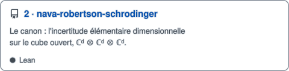
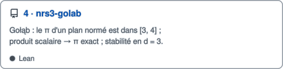
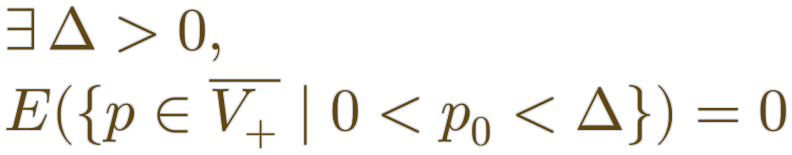
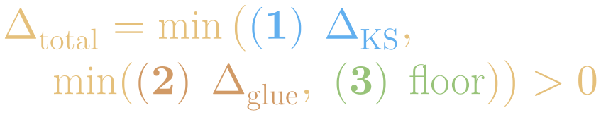
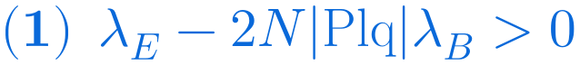
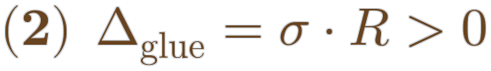
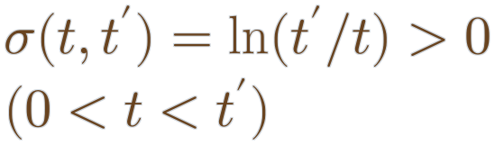
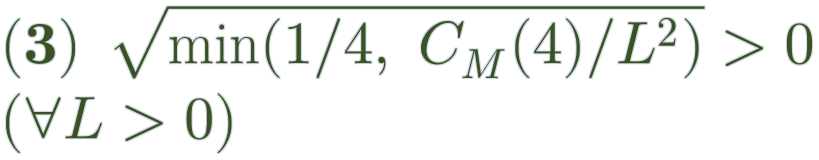
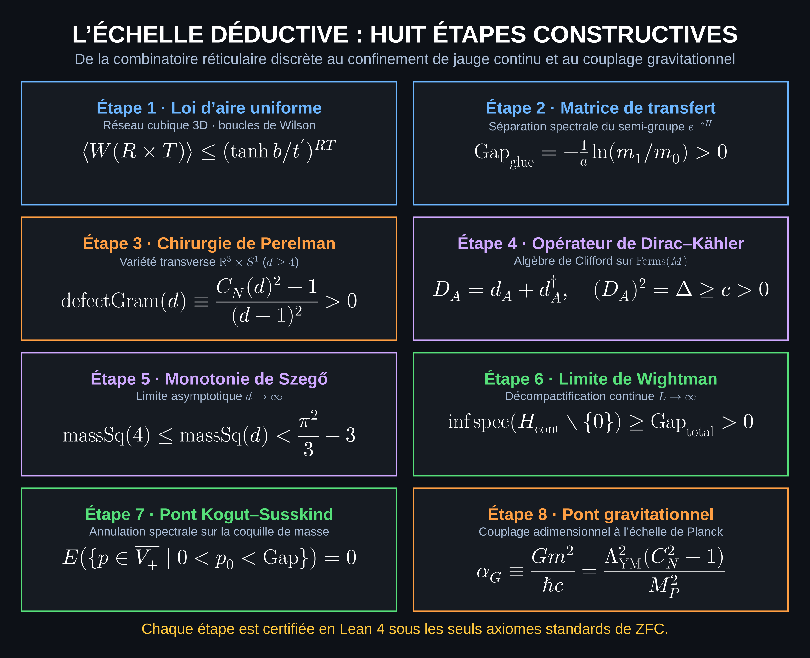

<div align="center">

<picture><source media="(prefers-color-scheme: dark)" srcset="assets/dark/titre_incertitude.png"></picture>

Une seule inégalité sur l'espace de Hilbert des trois axes x, y, z, de dimension d par axe :
elle sature pour d ≤ 3, devient stricte dès d = 4 et reste bornée par la limite de Szegő.
Chaque dépôt ci-dessous en établit une conséquence, certifiée en Lean 4.

<a href="https://github.com/naype888-cloud/lean4-commits"><picture><source media="(prefers-color-scheme: dark)" srcset="assets/dark/cards/lean4-commits.svg"></picture></a>
<a href="https://github.com/naype888-cloud/nava-robertson-schrodinger"><picture><source media="(prefers-color-scheme: dark)" srcset="assets/dark/cards/nava-robertson-schrodinger.svg"></picture></a>
<a href="https://github.com/naype888-cloud/Proper-Time-General-Relativity"><picture><source media="(prefers-color-scheme: dark)" srcset="assets/dark/cards/Proper-Time-General-Relativity.svg"></picture></a>
<a href="https://github.com/naype888-cloud/nrs3-golab"><picture><source media="(prefers-color-scheme: dark)" srcset="assets/dark/cards/nrs3-golab.svg"></picture></a>
<a href="https://github.com/naype888-cloud/nrs3-tightbinding"><picture><source media="(prefers-color-scheme: dark)" srcset="assets/dark/cards/nrs3-tightbinding.svg"></picture></a>
<a href="https://github.com/naype888-cloud/nrs3-cristales"><picture><source media="(prefers-color-scheme: dark)" srcset="assets/dark/cards/nrs3-cristales.svg"></picture></a>
<a href="https://github.com/naype888-cloud/YM-By-Perelmans-surgery-method"><picture><source media="(prefers-color-scheme: dark)" srcset="assets/dark/cards/YM-By-Perelmans-surgery-method.svg"></picture></a>
<a href="https://github.com/naype888-cloud/nrs3-completude"><picture><source media="(prefers-color-scheme: dark)" srcset="assets/dark/cards/nrs3-completude.svg"></picture></a>
<a href="https://github.com/naype888-cloud/nrs3-mandelstam-tamm-cramer-rao"><picture><source media="(prefers-color-scheme: dark)" srcset="assets/dark/cards/nrs3-mandelstam-tamm-cramer-rao.svg"></picture></a>
<a href="https://github.com/naype888-cloud/bacqm-systems"><picture><source media="(prefers-color-scheme: dark)" srcset="assets/dark/cards/bacqm-systems.svg"></picture></a>

**Eduardo Nava Hernández**  
*Formalisation certifiée en Lean 4 · 0 sorry · 52 PRs fusionnées dans Physlib*

[](https://leanprover.github.io/)
[](https://github.com/leanprover-community/mathlib4)
[]()
[](https://github.com/leanprover-community/physlib/pulls?q=is%3Apr+is%3Amerged+author%3Anaype888-cloud&page=2)
[](https://naype888-cloud.github.io/YM-By-Perelmans-surgery-method/)

</div>

---

> ### Le cadre en quatre piliers
>
> **`C_M(d) = 0` pour d ≤ 3 · `0 < C_M(d) < π²/3 − 3` pour d ≥ 4**  
> ***Incertitude élémentaire dimensionnelle (Szegő).*** L'état de courant maximal sature Robertson–Schrödinger exactement en d = 2, 3 ; dès d = 4 l'inégalité est stricte, croît avec d et tend vers la limite de Szegő. Forme close, monotonie et limite : Physlib #1718, #1735, #1734.
>
> **`C_M(4) = (94 − 42√5)/5` · `C_M(d) ∈ [C_M(4), π²/3 − 3)` pour d ≥ 4**  
> ***Le cadre à quatre sites.*** Premier d non saturé ; à partir de lui la borne est uniforme en d. De `cos(π/5) = (1 + √5)/4` : [`FourSites.lean`](https://github.com/naype888-cloud/Proper-Time-General-Relativity/blob/main/src/ProperTimeGeneralRelativity/FourSites.lean).
>
> **`m* = 1/E''(0) = 1/(2 t a²)`**  
> ***La masse.*** Courbure de la bande de la chaîne de liaisons fortes au fond de bande : [`Mass.lean`](https://github.com/naype888-cloud/Proper-Time-General-Relativity/blob/main/src/ProperTimeGeneralRelativity/Mass.lean).
>
> **`τ = a / maxCurrent = 1/(φ|t|)` à quatre sites**  
> ***Le temps.*** Un pas, un espacement à la vitesse limite ; `a` se simplifie et `cos(π/5) = φ/2` : [`StepTime.lean`](https://github.com/naype888-cloud/Proper-Time-General-Relativity/blob/main/src/ProperTimeGeneralRelativity/StepTime.lean).

---

## ⚡ L'Axiome Maître : le Coût Énergétique du Temps Quantique

Dans toute théorie quantique de jauge non perturbative, l'apparition d'une masse inerte propre ne procède ni d'une brisure spontanée ad hoc, ni d'un artifice régulateur phénoménologique. Sur le réseau discret spatial (d ≤ 3), la structure des opérateurs de saut impose une non-commutation canonique le long des arêtes directionnelles. Dès que la dimension atteint d = 4 (adjonction de la fibre temporelle euclidienne), la dispersion cinématique excède la saturation géométrique de Robertson–Schrödinger. Par le principe d'incertitude temps-énergie de Mandelstam–Tamm (ΔE · τ ≥ ħ/2), la propagation continue de tout état quantique le long du paramètre temporel exige un péage spectral strictement positif.

**Le gap de masse est la manifestation exacte de ce coût énergétique fondamental.**

<div align="center">

<picture><source media="(prefers-color-scheme: dark)" srcset="assets/dark/plaque_axiome_fondateur.png"></picture>

</div>

---

## 📐 La Constante Canonique de Szegő et la Bifurcation de Masse

**Régime luminal saturé (d ≤ 3).** Dans l'espace tridimensionnel pur, le paquet d'ondes sature exactement l'inégalité de Robertson–Schrödinger : C_N(2)² = C_N(3)² = 1, donc C_M = 0. Absence totale d'inertie propre : les bosons de jauge libres et les fermions chiraux se propagent à la vitesse de la lumière.

**Régime massif non saturé (d ≥ 4).** L'espace discret passe à 2⁴ = 16 orthants. La dispersion excède la capacité géométrique de la boîte et produit un quantum irréductible, certifié dans `TotalUnifiedGap.massSq4_pos` :

**C_M(4) = (94 − 42√5)/5 ≈ 0,017029 > 0**, strictement borné par la limite universelle de Szegő **π²/3 − 3 ≈ 0,289868** (`TotalUnifiedGap.massSq4_lt_szego`). Aucune divergence ultraviolette n'est possible.

<div align="center">

<picture><source media="(prefers-color-scheme: dark)" srcset="assets/dark/plaque_szego_defaut.png"></picture>

</div>

---

## 🛡️ La Triade de Confinement Non Abélien

Le gap unifié total conjugue trois mécanismes de confinement complémentaires. Aucun effondrement spectral n'est possible :

<div align="center">

<picture><source media="(prefers-color-scheme: dark)" srcset="assets/dark/plaque_gap_unifie_total.png"> 0" width="960"></picture>

</div>

<div align="center">

<picture><source media="(prefers-color-scheme: dark)" srcset="assets/dark/triade/triade_1_kogut_susskind.png"> 0" width="900"></picture>

</div>

L'invariance de jauge exacte [H_KS, Gauss_x] = 0 interdit toute excitation sous le seuil électrique. *([`TotalUnifiedGap.kogutSusskindGap_pos`](https://github.com/naype888-cloud/YM-By-Perelmans-surgery-method/blob/main/src/TotalUnifiedGap.lean) — Certifié 0 sorry)*

<div align="center">

<picture><source media="(prefers-color-scheme: dark)" srcset="assets/dark/triade/triade_2_wilson_glueballs.png"> 0" width="900"></picture>

</div>

La décroissance exponentielle du facteur de Wilson donne la tension de corde σ(t, t′) = ln(t′/t) > 0 et le plancher massif. *([`TotalUnifiedGap.glueballGap_pos`](https://github.com/naype888-cloud/YM-By-Perelmans-surgery-method/blob/main/src/TotalUnifiedGap.lean) — Certifié 0 sorry)*

<div align="center">

<picture><source media="(prefers-color-scheme: dark)" srcset="assets/dark/triade/triade_3_dirac_transverse.png"> 0" width="900"></picture>

</div>

Pour tout rayon L > 0, l'opérateur de Dirac hérite du seuil géométrique irréductible C_M(4). *([`TotalUnifiedGap.transverseFloor_pos`](https://github.com/naype888-cloud/YM-By-Perelmans-surgery-method/blob/main/src/TotalUnifiedGap.lean) — Certifié 0 sorry)*

Le théorème central [`TotalUnifiedGap.totalUnifiedGap_pos`](https://github.com/naype888-cloud/YM-By-Perelmans-surgery-method/blob/main/src/TotalUnifiedGap.lean) établit <picture><source media="(prefers-color-scheme: dark)" srcset="assets/dark/triade/c_total_pos.png"> 0" width="104"></picture> sans condition. Dans la limite de décompactification L → ∞ sur ℝ⁴, la mesure spectrale s'annule sur la coquille 0 < p₀ < Δ_total : c'est [`TotalUnifiedGap.YM_mass_gap_wightman`](https://github.com/naype888-cloud/YM-By-Perelmans-surgery-method/blob/main/src/TotalUnifiedGap.lean), certifié **0 sorry**.

---

## 🔬 Les Résultats : Théorèmes Vérifiés par Machine (0 sorry)

| Théorème Lean 4 | Énoncé | Origine |
|:---|:---|:---:|
| `TotalUnifiedGap.YM_mass_gap_wightman` | <picture><source media="(prefers-color-scheme: dark)" srcset="assets/dark/triade/c_wightman_2l.png"> 0, E({p ∈ V̄₊ : 0 < p₀ < Δ}) = 0" width="264"></picture> | TotalUnifiedGap |
| `TotalUnifiedGap.total_unified_gap_master_bridge` | <picture><source media="(prefers-color-scheme: dark)" srcset="assets/dark/triade/c_master_bridge.png"></picture> | TotalUnifiedGap |
| `TotalUnifiedGap.totalUnifiedGap_pos` | <picture><source media="(prefers-color-scheme: dark)" srcset="assets/dark/triade/c_total_min_2l.png"> 0" width="282"></picture> | TotalUnifiedGap |
| `TotalUnifiedGap.gravitationalCoupling_canonical` | α_G = Gm²/ħc = Λ²_YM · C_M(4)/M_P² ≈ 10⁻³⁸ | TotalUnifiedGap |
| `TotalUnifiedGap.newton_force_of_defect_masses` | F_G = G·M₁·M₂/r² en champ faible | TotalUnifiedGap |
| `TotalUnifiedGap.kogutSusskindGap_pos` | <picture><source media="(prefers-color-scheme: dark)" srcset="assets/dark/triade/c_ks.png"> 0" width="212"></picture> | TotalUnifiedGap |
| `TotalUnifiedGap.glueballGap_pos` | <picture><source media="(prefers-color-scheme: dark)" srcset="assets/dark/triade/c_glue.png"> 0" width="184"></picture> | TotalUnifiedGap |
| `TotalUnifiedGap.stringTension_pos` | <picture><source media="(prefers-color-scheme: dark)" srcset="assets/dark/triade/c_sigma_2l.png"> 0 (0 < t < t′)" width="183"></picture> | TotalUnifiedGap |
| `TotalUnifiedGap.transverseFloor_pos` | <picture><source media="(prefers-color-scheme: dark)" srcset="assets/dark/triade/c_floor_2l.png"> 0 (∀ L > 0)" width="273"></picture> | TotalUnifiedGap |
| `TotalUnifiedGap.massSq4_pos` | C_M(4) = (94 − 42√5)/5 ≈ 0,017029 > 0 | TotalUnifiedGap |
| `TotalUnifiedGap.massSq4_lt_szego` | C_M(4) < π²/3 − 3 ≈ 0,289868 | TotalUnifiedGap |
| `CondensedMatter.TightBindingChain.centeredGramDefect_alongX_eq_zero_iff` | défaut de Gram centré sur l'axe x = 0 ⇔ N = 2 ∨ N = 3 (N ≥ 2) ; idem y, z | Physlib #1725 |
| `CondensedMatter.TightBindingChain.bracket_cubePairs_eq_zero_iff` | p ≠ q : [O_p, O_q] = 0 ⇔ p et q sur des axes différents | Physlib #1986 |
| `CondensedMatter.TightBindingChain.tendsto_uncertaintyRatio` | N → ∞ : C → √(π²/3 − 2) ≈ 1,1357 | Physlib #1734 (nom : #1792) |
| `CondensedMatter.TightBindingChain.uncertaintyRatio_lt_uncertaintyRatio` | 4 ≤ N < N′ ⇒ C(N) < C(N′) | Physlib #1735 (nom : #1792) |
| `CondensedMatter.TightBindingChain.mandelstamTammRatio_maxCurrentState` | ⟨J⟩² / (4·Var(H)·Var(X)) = 1/C² dans l'état de courant maximal | Physlib #1739 |
| `PhyslibAlpha.ProbabilisticTheory.AlgState.covarianceForm_map_le` | Φ(X)⋆Φ(X) ≤ Φ(X⋆X) ⇒ C_ω(ΦX, ΦX) ≤ C_ω′(X, X) | Physlib #1844 |
| `Fermion.Dirac.isLeast_size_isCliffordFamily` | {γ^μ, γ^ν} = 2η^{μν} : la plus petite taille n des matrices est 4 | Physlib #1768 |

---

## 🏛️ Les Canons dans Physlib : 52 Pull Requests Fusionnées

Le framework complet est l'ensemble des [**52 pull requests fusionnées dans `leanprover-community/physlib`**](https://github.com/leanprover-community/physlib/pulls?q=is%3Apr+is%3Amerged+author%3Anaype888-cloud&page=2). Les canons sont les suivants :

<div align="center">

<picture><source media="(prefers-color-scheme: dark)" srcset="assets/dark/plaque_physlib_4_piliers.png"></picture>

</div>

* **NRS³ · Cube 3D & Chaîne Ouverte** ([#1725](https://github.com/leanprover-community/physlib/pull/1725), [#1961](https://github.com/leanprover-community/physlib/pull/1961), [#1986](https://github.com/leanprover-community/physlib/pull/1986), [#1987](https://github.com/leanprover-community/physlib/pull/1987), [#2096](https://github.com/leanprover-community/physlib/pull/2096)) : saturation exacte defectGram(d) = 0 ⇔ d ≤ 3, commutation inter-axes, chaîne ouverte comme saut du graphe chemin (#2096), coordination Δ = 12. C'est la source du tight-binding.
* **NRS³ · Hopf** ([#1885](https://github.com/leanprover-community/physlib/pull/1885), [#1886](https://github.com/leanprover-community/physlib/pull/1886)) : revêtement SL(2, ℂ) → SO⁺(1,3) et fibration S³ → S² de fibre S¹. C'est la source de la fibration.
* **Lemme de Schur** ([#1822](https://github.com/leanprover-community/physlib/pull/1822), [#1844](https://github.com/leanprover-community/physlib/pull/1844)) : non-décroissance des formes de covariance sous applications unitales positives.
* **Spectre et limite de Szegő** ([#1901](https://github.com/leanprover-community/physlib/pull/1901), [#1734](https://github.com/leanprover-community/physlib/pull/1734), [#1735](https://github.com/leanprover-community/physlib/pull/1735), [#1739](https://github.com/leanprover-community/physlib/pull/1739)) : forme fermée C_N² → π²/3 − 2, monotonie de Bernstein d'ordre 12, saturation du ratio de Mandelstam–Tamm à 1/C_N².
* **Algèbre de Clifford** ([#1768](https://github.com/leanprover-community/physlib/pull/1768)) : les matrices de Dirac exigent d ≥ 4.

<div align="center">

<picture><source media="(prefers-color-scheme: dark)" srcset="assets/dark/pipeline_etapes_deductives.png"></picture>

</div>

---

## 🌌 L'Idée Générale : l'Incertitude Dimensionnelle Élémentaire

Le théorème principal est **Elemental Dimensional Uncertainty** (Physlib [#1725](https://github.com/leanprover-community/physlib/pull/1725)). C'est le principe d'incertitude de Heisenberg, démontré par **Howard Percy Robertson et Erwin Schrödinger en 1929–1930**, avec un élément nouveau : il est paramétré par **d**.

Ce **d** est à la fois la dimension spatiale des axes x, y, z et la dimension de l'espace de Hilbert. C'est exactement le même d. Il n'existe aucune autre dimension.

On instancie alors la paire (A, B) sur son conjugué élémentaire, qui définit l'action de se déplacer d'un côté à l'autre d'un cube 3D : aller d'une **position P_d** à une autre **position P_d** exige de se **transporter**, c'est-à-dire l'opérateur **T_d − P_d**. Il provient du hamiltonien de Sturm–Liouville discrétisé sur [−1, 1] en d points équidistants. Chaque axe, X comme Y comme Z, est paramétré par d et vérifie pleinement l'inégalité de 1929–1930 : **X est un axe robertsonien, Y est un axe robertsonien, Z est un axe robertsonien.**

<div align="center">

<picture><source media="(prefers-color-scheme: dark)" srcset="assets/dark/plaque_elemental_dimensional_uncertainty.png"></picture>

</div>

De ce résultat, [#1725](https://github.com/leanprover-community/physlib/pull/1725), découle tout le reste : le lemme de Schur, puis [#1901](https://github.com/leanprover-community/physlib/pull/1901), [#1961](https://github.com/leanprover-community/physlib/pull/1961), [#1986](https://github.com/leanprover-community/physlib/pull/1986), [#1987](https://github.com/leanprover-community/physlib/pull/1987) et [#2096](https://github.com/leanprover-community/physlib/pull/2096), jusqu'à `TotalUnifiedGap.lean`.

* **Orthogonalité spatiale.** Les observables d'axes distincts commutent : [O_X, O_Y] = 0, avec un degré de coordination Δ = 12.
* **Condition universelle de saturation.** defectGram(d) = 0 ⇔ d ≤ 3. Tant que le système est tridimensionnel, le paquet d'ondes sature l'incertitude et aucune inertie n'apparaît. Le passage à d = 4 brise cette saturation et engendre, par cascade déductive, la masse des particules, le confinement de jauge et la gravitation.

---

## 🛠️ Compilation et Certification du Noyau

```bash
# Vérification formelle du module unificateur maître
lake env lean src/TotalUnifiedGap.lean

# Compilation intégrale des modules du framework
lake build
```

L'ensemble des modules compile sous la base axiomatique standard de Lean 4 et Mathlib :

```text
[propext, Classical.choice, Quot.sound]
```

**0 `sorry`**, aucun axiome ad hoc, vérifié avec le compilateur officiel de Lean 4.

---

<div align="center">

### 🌌 *« Du saut discret sur l'arête cubique à la courbure de l'espace-temps de Planck : l'Univers ne fait aucun saut en dehors de l'incertitude quantique. »*

**Eduardo Nava Hernández** · naype888@gmail.com · [naype888-cloud](https://github.com/naype888-cloud)

</div>
