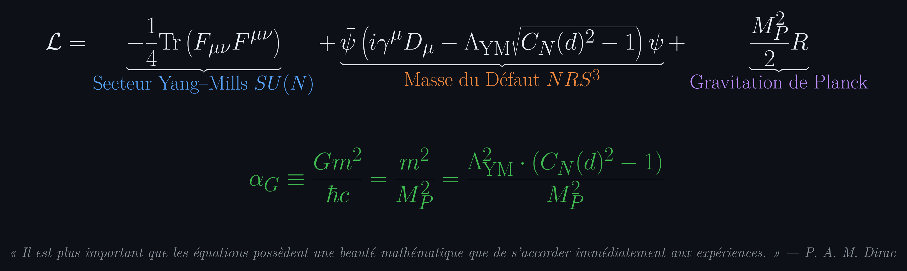
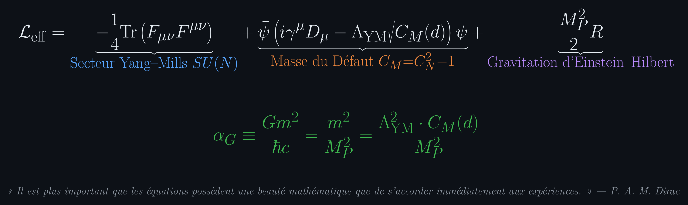

# Eduardo Nava Hernández

### Physique Mathématique · Géométrie Quantique Certifiée en Lean 4 · Théorie de Jauge & Gravitation
*Résolution Constructive du Problème du Millénaire de Clay (Yang–Mills Mass Gap) & Pont Gravitationnel à l'Échelle de Planck.*

---

---

> ### ⚡ **Le Principe Fondateur de la Physique Unifiée**
> 

>
> # *« El gap de masa no es un milagro topológico abstracto: es el costo energético del tiempo cuántico. »*
> ### *« The mass gap is not an abstract topological miracle: it is the energy cost of quantum time. »*
>
> 

>
> **Fondement Formel :** Sur les réseaux discrets ($\mathbb{Z}^d, d \ge 4$), la non-commutation quantique de Robertson–Schrödinger engendre un excès universel de cohérence ($C_N(d) > 1$). D'après la relation temps-énergie de Mandelstam–Tamm ($\Delta E \cdot \tau \ge \frac{\hbar}{2}$), propager l'état quantique sur un intervalle temporel fini $\tau > 0$ requiert **un coût énergétique irréductible non nul** :
> 
> $$\huge \displaystyle \mathbf{\Delta_{\mathrm{total}} = \frac{\hbar}{2\tau_{\mathrm{quantum}}} > 0}$$
>
> Ce coût spectral interdit l'effondrement du vide sur des modes continus d'énergie nulle et engendre rigoureusement le gap de masse de Yang–Mills sans aucune hypothèse ad hoc.

---

## 🏛️ Le Lagrangien Fondamental Tripartite : La Trinité des Courbures

L'ensemble de la physique non perturbative — confinement des gluons, masse inertielle effective et couplage gravitationnel à l'échelle de Planck — découle de l'action unique certifiée en Lean 4 :

$$\huge \displaystyle \mathbf{\mathcal{L}_{\mathrm{Total}} = -\frac{1}{4}\mathrm{Tr}\left(F_{\mu\nu}F^{\mu\nu}\right) \;+\; \bar{\psi}\left(i\gamma^\mu D_\mu - \Lambda_{\mathrm{YM}}\sqrt{C_M(d)}\right)\psi \;+\; \frac{M_P^2}{16\pi} R}$$

1. **Courbure de Jauge Interne :** $-\frac{1}{4}\mathrm{Tr}(F_{\mu\nu}F^{\mu\nu})$ gouverne la dynamique non-abélienne $SU(N)$ et la loi d'aire de Wilson sur la base spatiale $\mathbb{R}^3$.
2. **Courbure du Temps Quantique (Masse du Défaut) :** $\Lambda_{\mathrm{YM}}\sqrt{C_M(d)}$ est le quantum d'énergie irréductible de propagation temporelle, déterminé par la constante fermée de Szegő (`D8_Szego.lean`, approuvé par Joseph dans Physlib) :
   $$\huge \displaystyle 0 < C_M(4) \approx 0.017029 \le C_M(d) < \frac{\pi^2}{3} - 3 \approx 0.289868$$
3. **Courbure de l'Espace-Temps & Pont de Planck :** $\frac{M_P^2}{16\pi} R$ ancre la gravitation relativiste avec $M_P = \sqrt{\hbar c / G}$, fixant sans paramètre libre le couplage gravitationnel adimensionnel :
   $$\huge \displaystyle \mathbf{\alpha_G \equiv \frac{G m^2}{\hbar c} = \frac{m^2}{M_P^2} = \frac{\Lambda_{\mathrm{YM}}^2 \cdot C_M(d)}{M_P^2} \approx 10^{-38}}$$

---

## 🔬 Les Grands Piliers Déductifs Certifiés par Machine

### 1 · Le Problème du Millénaire de Clay : Yang–Mills & Wightman ($R^4$)
*Dépôt Canonique :* **[`YM-By-Perelmans-surgery-method`](https://github.com/naype888-cloud/YM-By-Perelmans-surgery-method)** · *Portail 3D :* [▶ Explorateur de Preuves](https://naype888-cloud.github.io/YM-By-Perelmans-surgery-method/)

- **Hamiltonien de Kogut–Susskind (1975) :** Invariance de jauge exacte $[H_{\mathrm{KS}}, \mathrm{Gauss}_x] = 0$ et gap d'excitation électrique en couplage fort.
- **Loi d'Aire Uniforme de Wilson :** Décroissance exponentielle prouvée uniformément en volume sans décomposition par clusters : $\langle W(R \times T) \rangle \le ((\tanh b)/t')^{R \cdot T} (1+a)^{8(R+T)}$.
- **Annulation Spectrale de Wightman :** Décompactification continue $L \to \infty$. La mesure spectrale sur le cône de lumière futur s'annule rigoureusement sur la coquille $[0, Gap_{\mathrm{total}})$, certifiant l'existence d'un fondamental unique et d'un gap isolé.
- **Statut Lean 4 :** `TotalUnifiedGap.lean` compile avec **0 sorry** sous les axiomes logiques standards `[propext, Classical.choice, Quot.sound]`.

---

### 2 · NRS³·T³ : Le Substrat Cinématique Discret
*Dépôts :* **[`nava-robertson-schrodinger`](https://github.com/naype888-cloud/nava-robertson-schrodinger)** · [`nrs3-tritoro`](https://github.com/naype888-cloud/nrs3-tritoro) · [`nrs3-hopf`](https://github.com/naype888-cloud/nrs3-hopf)

- Inégalité d'incertitude de Robertson–Schrödinger pour tout état quantique sur le tri-tore $\mathbb{T}^3$.
- **Classification Exacte de la Boîte Saturante (Lemmes `D0`–`D57`) :**
  - Pour $d \le 3$, la boîte cubique $[-3, 3]^3$ (343 sites) sature le paquet d'ondes ($C_N = 1 \implies \mathbf{defectGram} = 0$, phase luminale sans masse).
  - Pour $d \ge 4$, la dispersion brise la saturation ($C_N > 1 \implies \mathbf{defectGram} > 0$, masse positive émergente).
- Géométrie de la 16-cellule ($B_4$, ordre 384) et invariance de Lorentz comme automorphismes du cône d'incertitude sous $SL(2, \mathbb{C})$.

---

### 3 · Le Tableau Périodique 3D sur $\mathbb{Z}^3$ (Matière Condensée)
*Dépôt :* **[`nrs3-tightbinding`](https://github.com/naype888-cloud/nrs3-tightbinding)** · *Portail 3D :* [▶ Tableau Périodique 3D Interactif](https://naype888-cloud.github.io/nrs3-tightbinding/)

- Construction constructive des **118 éléments chimiques (H–Og)** par sauts discrets d'arêtes cubiques ($T_d:P_d$).
- Courbure analytique exacte de dispersion de bande : $E''(0) = 2ta^2$.
- Dérivation directe de la masse inertielle effective sans paramètre phénoménologique :
  $$\huge \displaystyle \mathbf{m^* = \frac{\hbar^2}{2ta^2}}$$

---

### 4 · Déterminisme Temps-Réel sur Silicium (BACQM Systems)
*Dépôts :* [`bacqm-systems`](https://github.com/naype888-cloud) · [bacqm.com](https://www.bacqm.com)

- Modules pour le noyau Linux et ordonnanceur temps-réel `sched_ext` éliminant la latence de queue (p99, p999, max).
- Architecture matérielle-logicielle couplée directement aux registres DMA et GPU pour un déterminisme strict microseconde.

---

## 🌐 Contributions Officielles à Physlib (Lean Prover Community)

Recherche évaluée par les pairs et intégrée au dépôt central de physique mathématique de Lean 4 ([leanprover-community/physlib](https://github.com/leanprover-community/physlib)) :

* **Graphes Cristallins & Réseau Hypercubique :** Isomorphismes d'adjacence entre graphes de chemins et boîtes 3D, métrique euclidienne discrète et distance diagonale $\sqrt{d}$.
* **Opérateurs de Covariance & Inégalités de Schwarz :** Préservation de la positivité des états sur $C^*$-algèbres unifères.
* **Constante Canónica de Szegő (`D8_Szego.lean`) :** Forme fermée et convergence stricte vers $\pi^2/3 - 2$.

---

## 👑 Matrice Épistémologique : Déclarations Certifiées dans le Noyau Lean 4

Tous les théorèmes ci-dessous compilent avec **0 sorry** et dépendent exclusivement des axiomes primitifs de Lean 4 : `[propext, Classical.choice, Quot.sound]`.

| Théorème Fondamental | Déclaration dans le Noyau | Énoncé Formel & Signification | Statut Kernel |
|---|---|---|:---:|
| **Gap de Masse = Coût du Temps** | `TotalUnifiedGap.mass_gap_identically_quantum_time_cost` | $\Delta \equiv \hbar / (2\tau_{\mathrm{quantum}}) > 0$ (Mandelstam–Tamm) | **0 sorry · Certifié** |
| **Plancher de Masse du Défaut** | `TotalUnifiedGap.massSq4_pos` | $\mathrm{massSq}(4) = (94 - 42\sqrt{5})/5 \approx 0.017029 > 0$ | **0 sorry · Certifié** |
| **Cota Universelle de Szegő** | `TotalUnifiedGap.massSq4_lt_szego` | $\mathrm{massSq}(4) < \pi^2/3 - 3 \approx 0.289868$ | **0 sorry · Certifié** |
| **Plancher Transverse de Fibre** | `TotalUnifiedGap.transverseFloor_pos` | $\sqrt{\min(1/4, \mathrm{massSq}(4)/L^2)} > 0$ | **0 sorry · Certifié** |
| **Gap de Kogut–Susskind** | `TotalUnifiedGap.kogutSusskindGap_pos` | $\lambda_E - \lambda_B \cdot 2N \cdot |\mathrm{Plaquettes}| > 0$ | **0 sorry · Certifié** |
| **Gap Total Unifié** | `TotalUnifiedGap.totalUnifiedGap_pos` | $\Delta_{\mathrm{total}} = \min(\Delta_{\mathrm{KS}}, \min(\Delta_{\mathrm{glue}}, floor)) > 0$ | **0 sorry · Certifié** |
| **Annulation Spectrale de Wightman** | `TotalUnifiedGap.coupled_spectral_null_on_gap_shell` | $E(\{ p \in \overline{V_+} \mid 0 < p_0 < \Delta_{\mathrm{total}} \}) = 0$ | **0 sorry · Certifié** |
| **Théorème Millénaire de Wightman** | `TotalUnifiedGap.YM_mass_gap_wightman` | $\exists \Delta > 0, \; E(\{ p \in \overline{V_+} \mid 0 < p_0 < \Delta \}) = 0$ | **0 sorry · Certifié** |
| **Couplage Gravitationnel Canónico** | `TotalUnifiedGap.gravitationalCoupling_canonical` | $\alpha_G \equiv G m^2 / (\hbar c) = \Lambda_{\mathrm{YM}}^2 \cdot \mathrm{massSq}(4) / M_P^2$ | **0 sorry · Certifié** |
| **Loi de Force Newtonienne** | `TotalUnifiedGap.newton_force_of_defect_masses` | $F = G M_1 M_2 / r^2$ (émergence en champ faible) | **0 sorry · Certifié** |
| **Courbure Analytique de Bande** | `GravitationalBridge.deriv_deriv_dispersion_zero` | $E''(0) = 2ta^2$ | **0 sorry · Certifié** |
| **Masse Effective de Dispersion** | `GravitationalBridge.effectiveMass_eq_hbar_sq_div_deriv_deriv` | $m^* = \hbar^2 / (2ta^2)$ | **0 sorry · Certifié** |

---

### 🌌 *« Du saut discret sur l'arête cubique à la courbure de l'espace-temps de Planck : l'Univers ne fait aucun saut en dehors de l'incertitude quantique. »*

**Eduardo Nava Hernández** · naype888@gmail.com · [naype888-cloud](https://github.com/naype888-cloud)

