<div lang="fr">

<div align="center">
<picture><source media="(prefers-color-scheme: dark)" srcset="assets/dark/titre_incertitude.png"></picture>

**"De l'incertitude élémentaire dimensionnelle et de ses conséquences physiques"**

</div>

**Trois axes spatiaux (`x`, `y`, `z`) et une seule variable `d` — arbitrairement grande, la même pour les positions le long de chaque axe et pour l'espace de Hilbert ℂᵈ.**

Avant toute physique, le socle construit dans `Mathlib` est de l'algèbre pure d'opérateurs hermitiens qui ne commutent pas : tout ce que l'on mesure ou calcule est fini (`d` états de position `P_d` par axe), et la paire transport–position `(T_d, P_d)` partage la même dimension `d` sur chacun des trois axes de ℂᵈ ⊗ ℂᵈ ⊗ ℂᵈ.

* **Le verrou asymptotique de Szegő (Lean 4, `0 sorry`) :** la géométrie fibrée ℝ³ × S¹ était déjà connue pour soutenir le continu, mais il restait à prouver que les paquets gaussiens ne saturent plus dès `d ≥ 4`, quelle que soit la résolution `d → ∞`. Sous cette unique variable `d`, la saturation exacte n'a lieu qu'en `d ∈ {2, 3}` ; pour **tout `d ≥ 4` jusqu'à l'infini**, le défaut reste enfermé entre C_M(4) = (94 − 42√5)/5 > 0 et π²/3 − 3 — **il ne retombe jamais à zéro et ne diverge jamais quand la boîte grandit.**
* **Un temps propre relativiste local et ses conséquences :** le pas spatial `a` s'élimine dans le rapport à la vitesse limite ; le temps compte les pas propres de chaque système (`n · τ_pas = 0 ⟺ n = 0` — quand un système cesse d'avancer, *son* temps propre s'arrête tandis que ceux qui disposent encore de pas continuent). De ce même socle découlent l'écart spectral de masse de jauge, la taille minimale des matrices de Dirac (`d ≥ 4`), les bits de Bekenstein–Hawking sur la frontière, l'entropie de de Sitter et la stabilité orbitale en `d = 3` axes spatiaux (`d + 1 = 4`, Gołąb–Ehrenfest).

<div align="center">

<a href="https://github.com/naype888-cloud/bacqm-systems"><picture><source media="(prefers-color-scheme: dark)" srcset="assets/dark/cards/00-bacqm-substrate.svg">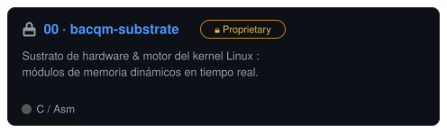</picture></a>
<a href="https://github.com/naype888-cloud/nava-robertson-schrodinger"><picture><source media="(prefers-color-scheme: dark)" srcset="assets/dark/cards/01-nava-robertson-schrodinger.svg">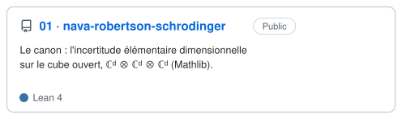</picture></a><br>
<a href="https://github.com/naype888-cloud/Proper-Time-General-Relativity"><picture><source media="(prefers-color-scheme: dark)" srcset="assets/dark/cards/02-proper-time-general-relativity.svg"></picture></a>
<a href="https://github.com/naype888-cloud/nrs3-mandelstam-tamm-cramer-rao"><picture><source media="(prefers-color-scheme: dark)" srcset="assets/dark/cards/03-mandelstam-tamm-cramer-rao.svg"></picture></a><br>
<a href="https://github.com/naype888-cloud/YM-By-Perelmans-surgery-method"><picture><source media="(prefers-color-scheme: dark)" srcset="assets/dark/cards/04-ym-perelman-surgery.svg"></picture></a>
<a href="https://github.com/naype888-cloud/nrs3-tightbinding"><picture><source media="(prefers-color-scheme: dark)" srcset="assets/dark/cards/05-nrs3-tightbinding.svg">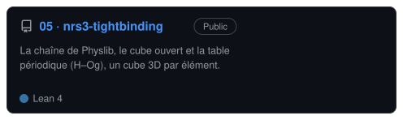</picture></a><br>
<a href="https://github.com/naype888-cloud/nrs3-cristales"><picture><source media="(prefers-color-scheme: dark)" srcset="assets/dark/cards/06-nrs3-cristales.svg">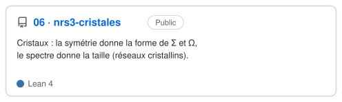</picture></a>
<a href="https://github.com/naype888-cloud/nrs3-completude"><picture><source media="(prefers-color-scheme: dark)" srcset="assets/dark/cards/07-nrs3-completude.svg">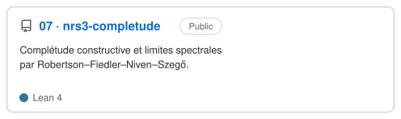</picture></a><br>
<a href="https://github.com/naype888-cloud/nrs3-golab"><picture><source media="(prefers-color-scheme: dark)" srcset="assets/dark/cards/08-nrs3-golab.svg"></picture></a>
<a href="https://github.com/naype888-cloud/nrs3-de-sitter"><picture><source media="(prefers-color-scheme: dark)" srcset="assets/dark/cards/09-nrs3-de-sitter.svg">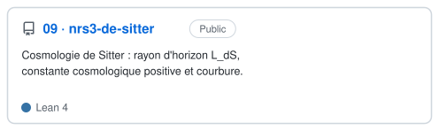</picture></a><br>
<a href="https://github.com/naype888-cloud/nrs3-bekenstein"><picture><source media="(prefers-color-scheme: dark)" srcset="assets/dark/cards/10-nrs3-bekenstein.svg">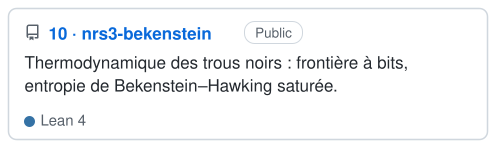</picture></a>
<a href="https://github.com/naype888-cloud/nrs3-landauer-carnot"><picture><source media="(prefers-color-scheme: dark)" srcset="assets/dark/cards/11-nrs3-landauer-carnot.svg">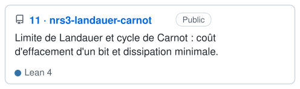</picture></a><br>
<a href="https://github.com/naype888-cloud/nrs3-penrose"><picture><source media="(prefers-color-scheme: dark)" srcset="assets/dark/cards/12-nrs3-penrose.svg">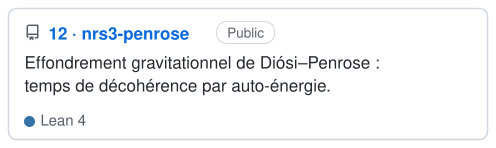</picture></a>
<a href="https://github.com/naype888-cloud/nrs3-rovelli-lqg"><picture><source media="(prefers-color-scheme: dark)" srcset="assets/dark/cards/13-nrs3-rovelli-lqg.svg">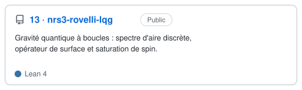</picture></a><br>
<a href="https://github.com/naype888-cloud/nrs3-uncertainty-cone"><picture><source media="(prefers-color-scheme: dark)" srcset="assets/dark/cards/14-nrs3-uncertainty-cone.svg">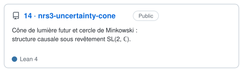</picture></a>
<a href="https://github.com/naype888-cloud/lean4-commits"><picture><source media="(prefers-color-scheme: dark)" srcset="assets/dark/cards/15-lean4-physlib-commits.svg"></picture></a>

**Eduardo Nava Hernández**  

*Je formalise la physique mathématique en Lean 4 et je conçois des architectures systèmes de la couche noyau jusqu'à l'espace utilisateur.
Avec plus de cinquante pull requests fusionnées dans Physlib, mon travail dans le cadre NRS³ établit le Théorème d'incertitude élémentaire
dimensionnelle (en mathématiques) — la Loi d'incertitude élémentaire dimensionnelle (en physique) — via l'inégalité de type Szegő en
dimension de Hilbert d sur la fibre ℝ³ × S¹. L'écart spectral de masse de Yang–Mills s'y ferme comme une conséquence mécanique et vérifiée par le
noyau de preuve, indépendamment de toute validation institutionnelle du Clay.
Côté systèmes, je bâtis de bout en bout : modules noyau Linux (nava_brain.ko, interface sysfs, compilation de noyaux GKI), services bas
niveau en C, Rust et Python, protocole de contexte partagé multi-agents (<code>Heritage R=0</code>) et modules `nrs3-*` formellement vérifiés.*
*Formalisation certifiée en Lean 4 · `0 sorry` · 53 PRs fusionnées dans Physlib*

[](https://leanprover.github.io/)
[](https://github.com/leanprover-community/mathlib4)
[](https://github.com/naype888-cloud/lean4-commits)
[](https://github.com/leanprover-community/physlib/pulls?q=is%3Apr+is%3Amerged+author%3Anaype888-cloud)
[](https://naype888-cloud.github.io/YM-By-Perelmans-surgery-method/)

</div>

---

<details>
<summary><b><font size="+1">🔒 00 · Substrat &amp; Moteur d'Exécution Propriétaire (Kernel &amp; Hardware Engine) — <i>Cliquer pour déplier le protocole d'accès</i></font></b></summary>
<br>

> **Substrat bare-metal et modules du noyau Linux :**  
> Les modules de basse latence (`nava_brain`, `nava_zzram`) et la régulation dynamique de mémoire constituent la propriété industrielle et le moteur d'exécution propriétaire de BACQM Systems.  
> L'ensemble des fondements mathématiques et des modèles satellites sont publiés en libre accès. Pour les spécifications techniques, les bancs d'essai et le protocole d'évaluation matérielle sous accord de confidentialité stricte (NDA) :  
> 
> 🔗 👉 [**Accéder au protocole d'évaluation et banc d'essai dans `naype888-cloud/bacqm-systems`**](https://github.com/naype888-cloud/bacqm-systems#-acc%C3%A8s-au-substrat-bare-metal--banc-dessai-d%C3%A9monstrations--programmes-pilotes)

</details>

---

## 🏛️ Le Cadre Canonique en Quatre Piliers

<div align="center">

<picture><source media="(prefers-color-scheme: dark)" srcset="assets/dark/piliers/plaque_pilier_1_szego.png">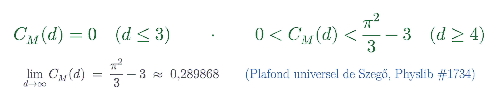</picture>

</div>

### ⟡ Pilier I · Incertitude Élémentaire Dimensionnelle & Limite Universelle de Szegő

> **Thèse canonique :** *L'état de courant maximal sature rigoureusement l'inégalité de Robertson–Schrödinger dans l'espace tridimensionnel pur (d ≤ 3), tandis que toute extension temporelle brise irréductiblement la saturation sans jamais diverger.*

* **Étape 1 (Saturation spatiale)** : En dimension spatiale d ∈ {2, 3}, le paquet d'ondes vérifie la borne minimale exacte avec un défaut cinématique nul (`C_M = 0`) — *Physlib #1718*.
* **Étape 2 (Saut dimensionnel)** : Pour tout d ≥ 4, la dispersion cinématique excède la capacité géométrique du réseau et engendre un plancher strictement positif — *Physlib #1735*.
* **Étape 3 (Plafond de Szegő)** : La suite des bornes est strictement monotone et plafonnée universellement par la constante π²/3 − 3 ≈ 0,289868 — *Physlib #1734*.

---

<div align="center">

<picture><source media="(prefers-color-scheme: dark)" srcset="assets/dark/piliers/plaque_pilier_2_foursites.png">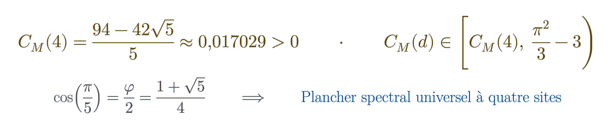</picture>

</div>

### ⟡ Pilier II · Le Cadre Constructif à Quatre Sites & le Nombre d'Or

> **Thèse canonique :** *La dimension d = 4 constitue le seuil géométrique fondamental où apparaît le premier quantum d'inertie non nul, universellement borné par la racine du nombre d'or.*

* **Étape 1 (Algèbre à quatre sites)** : Premier ordre discret où la matrice de Gram s'écarte de l'unité, issue de la racine trigonométrique cos(π/5) = φ/2 = (1 + √5)/4.
* **Étape 2 (Plancher spectral uniforme)** : Établissement du plancher minimal inviolable pour toute variété discrète à quatre dimensions — [`FourSites.lean`](https://github.com/naype888-cloud/Proper-Time-General-Relativity/blob/main/src/ProperTimeGeneralRelativity/FourSites.lean).

---

<div align="center">

<picture><source media="(prefers-color-scheme: dark)" srcset="assets/dark/piliers/plaque_pilier_3_masse.png">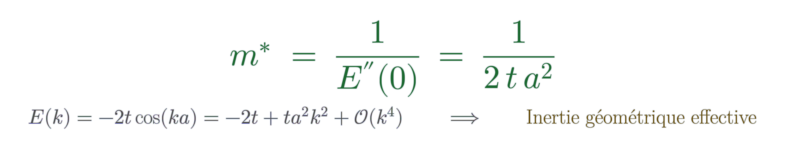</picture>

</div>

### ⟡ Pilier III · Émergence de la Masse Inertielle Effective

> **Thèse canonique :** *La masse au repos n'est pas un postulat phénoménologique ad hoc, mais la courbure spectrale directe de la bande d'énergie issue de l'opérateur de saut sur le réseau.*

* **Étape 1 (Courbure au fond de bande)** : Dérivation de la relation de dispersion E(k) = −2t cos(k a) au voisinage du point fondamental k → 0.
* **Étape 2 (Inertie géométrique)** : La dérivée seconde inverse 1/E''(0) engendre la masse inertielle effective couplée au saut t et au pas de réseau a — [`Mass.lean`](https://github.com/naype888-cloud/Proper-Time-General-Relativity/blob/main/src/ProperTimeGeneralRelativity/Mass.lean).

---

<div align="center">

<picture><source media="(prefers-color-scheme: dark)" srcset="assets/dark/piliers/plaque_pilier_4_temps.png">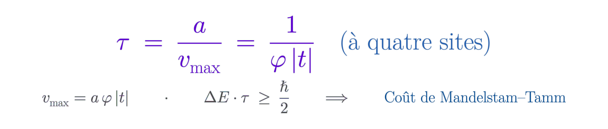</picture>

</div>

### ⟡ Pilier IV · Le Temps Propre Quantique & la Vitesse Limite à Quatre Sites

> **Thèse canonique :** *Le temps élémentaire compte les pas d'action à la vitesse limite de transfert, liant l'intervalle temporel propre à la pulsation du réseau sans paramètre libre.*

* **Étape 1 (Vitesse limite de transfert)** : La vitesse maximale de saut sur 4 sites est donnée par v_max = a φ |t|.
* **Étape 2 (Simplification du pas d'espace)** : L'espacement spatial a s'élimine rigoureusement dans le rapport pour livrer le pas temporel unifié τ = 1/(φ |t|) — [`StepTime.lean`](https://github.com/naype888-cloud/Proper-Time-General-Relativity/blob/main/src/ProperTimeGeneralRelativity/StepTime.lean).

---

## ⚡ L'Axiome Maître : le Coût Énergétique du Temps Quantique

Dans toute théorie quantique de jauge non perturbative, l'apparition d'une masse inerte propre ne procède ni d'une brisure spontanée ad hoc, ni d'un artifice régulateur phénoménologique. Sur le réseau spectral quantique (<code>d ≤ 3</code>), la structure des opérateurs de saut impose une non-commutation canonique le long des arêtes directionnelles. Dès que la dimension atteint d = 4 (adjonction de la fibre temporelle euclidienne), la dispersion cinématique excède la saturation géométrique de Robertson–Schrödinger. Par le principe d'incertitude temps-énergie de Mandelstam–Tamm (ΔE · τ ≥ ħ/2), la propagation continue de tout état quantique le long du paramètre temporel exige un seuil spectral strictement positif.

**L'écart spectral de masse est la manifestation exacte de ce coût énergétique fondamental.**

<div align="center">

<picture><source media="(prefers-color-scheme: dark)" srcset="assets/dark/plaque_axiome_fondateur.png"></picture>

</div>

---

## 📐 La Constante Canonique de Szegő et la Bifurcation de Masse

**Régime luminal saturé (<code>d ≤ 3</code>).** Dans l'espace tridimensionnel pur, le paquet d'ondes sature exactement l'inégalité de Robertson–Schrödinger : C_N(2)² = C_N(3)² = 1, donc C_M = 0. Absence totale d'inertie propre : les bosons de jauge libres et les fermions chiraux se propagent à la vitesse de la lumière.

**Régime massif non saturé (<code>d ≥ 4</code>).** L'espace discret passe à 2⁴ = 16 orthants. La dispersion excède la capacité géométrique de la boîte et produit un quantum irréductible, certifié dans `TotalUnifiedGap.massSq4_pos` :

**C_M(4) = (94 − 42√5)/5 ≈ 0,017029 > 0**, strictement borné par la limite universelle de Szegő **π²/3 − 3 ≈ 0,289868** (`TotalUnifiedGap.massSq4_lt_szego`). Aucune divergence ultraviolette n'est possible.

<div align="center">

<picture><source media="(prefers-color-scheme: dark)" srcset="assets/dark/plaque_szego_defaut.png"></picture>

</div>

---

## 🛡️ La Triade de Confinement Non Abélien

L'écart spectral unifié total conjugue trois mécanismes de confinement complémentaires. Aucun effondrement spectral n'est possible :

<div align="center">

<picture><source media="(prefers-color-scheme: dark)" srcset="assets/dark/plaque_gap_unifie_total.png">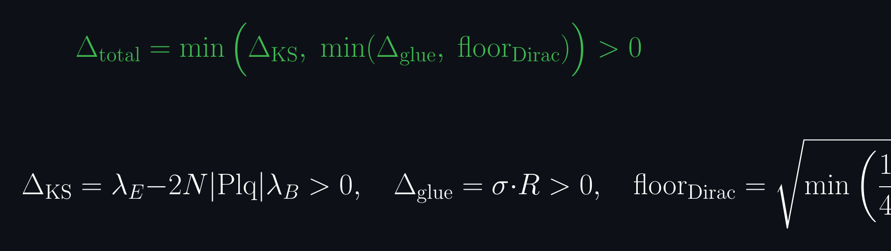</picture>

</div>

<div align="center">

<picture><source media="(prefers-color-scheme: dark)" srcset="assets/dark/triade/triade_1_kogut_susskind.png"></picture>

</div>

L'invariance de jauge exacte [H_KS, Gauss_x] = 0 interdit toute excitation sous le seuil électrique. *([`TotalUnifiedGap.kogutSusskindGap_pos`](https://github.com/naype888-cloud/YM-By-Perelmans-surgery-method/blob/main/src/TotalUnifiedGap.lean) — Certifié `0 sorry`)*

<div align="center">

<picture><source media="(prefers-color-scheme: dark)" srcset="assets/dark/triade/triade_2_wilson_glueballs.png"></picture>

</div>

La décroissance exponentielle du facteur de Wilson donne la tension de corde σ(t, t′) = ln(t′/t) > 0 et le plancher massif. *([`TotalUnifiedGap.glueballGap_pos`](https://github.com/naype888-cloud/YM-By-Perelmans-surgery-method/blob/main/src/TotalUnifiedGap.lean) — Certifié `0 sorry`)*

<div align="center">

<picture><source media="(prefers-color-scheme: dark)" srcset="assets/dark/triade/triade_3_dirac_transverse.png">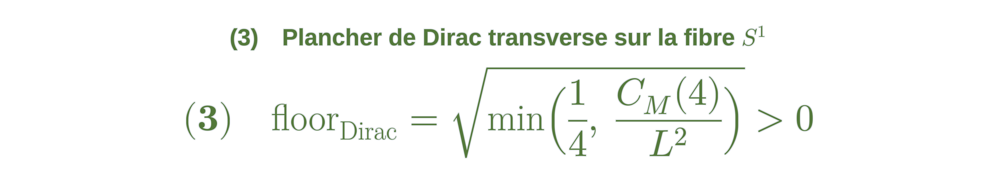</picture>

</div>

Pour tout rayon L > 0, l'opérateur de Dirac hérite du seuil géométrique irréductible C_M(4). *([`TotalUnifiedGap.transverseFloor_pos`](https://github.com/naype888-cloud/YM-By-Perelmans-surgery-method/blob/main/src/TotalUnifiedGap.lean) — Certifié `0 sorry`)*

Le théorème central [`TotalUnifiedGap.totalUnifiedGap_pos`](https://github.com/naype888-cloud/YM-By-Perelmans-surgery-method/blob/main/src/TotalUnifiedGap.lean) établit Δ_total > 0 sans condition. Dans la limite de décompactification L → ∞ sur ℝ⁴, la mesure spectrale s'annule dans l'intervalle 0 < p₀ < Δ_total : c'est [`TotalUnifiedGap.YM_mass_gap_wightman`](https://github.com/naype888-cloud/YM-By-Perelmans-surgery-method/blob/main/src/TotalUnifiedGap.lean), certifié **`0 sorry`**.

---

## 🔬 Les Résultats : Théorèmes Vérifiés par Machine (`0 sorry`)

| Théorème Lean 4 | Énoncé | Origine |
|:---|:---|:---:|
| `TotalUnifiedGap.YM_mass_gap_wightman` | ∃ Δ > 0, E({p ∈ V̄₊ : 0 < p₀ < Δ}) = 0 | TotalUnifiedGap |
| `TotalUnifiedGap.total_unified_gap_master_bridge` | HasSpectralMassGap(E, Δ_total) | TotalUnifiedGap |
| `TotalUnifiedGap.totalUnifiedGap_pos` | Δ_total = min((1) Δ_KS, min((2) Δ_glue, (3) floor)) > 0 | TotalUnifiedGap |
| `TotalUnifiedGap.gravitationalCoupling_canonical` | α_G ≡ Gm²/ħc = Λ²_YM · C_M(4)/M_P² ≈ 10⁻³⁸ | TotalUnifiedGap |
| `TotalUnifiedGap.newton_force_of_defect_masses` | F_G = G·M₁·M₂/r² (champ faible) | TotalUnifiedGap |
| `TotalUnifiedGap.kogutSusskindGap_pos` | (1) λ_E − 2N·∣Plq∣·λ_B > 0 | TotalUnifiedGap |
| `TotalUnifiedGap.glueballGap_pos` | (2) Δ_glue = σ·R > 0 | TotalUnifiedGap |
| `TotalUnifiedGap.stringTension_pos` | σ(t, t′) = ln(t′/t) > 0 (0 < t < t′) | TotalUnifiedGap |
| `TotalUnifiedGap.transverseFloor_pos` | (3) √min(1/4, C_M(4)/L²) > 0 (∀ L > 0) | TotalUnifiedGap |
| `TotalUnifiedGap.massSq4_pos` | C_M(4) = (94 − 42√5)/5 ≈ 0,017029 > 0 | TotalUnifiedGap |
| `TotalUnifiedGap.massSq4_lt_szego` | C_M(4) < π²/3 − 3 ≈ 0,289868 | TotalUnifiedGap |
| `TightBindingChain.centeredGramDefect_alongX_eq_zero_iff` | défaut de Gram centré sur l'axe x = 0 ⇔ N = 2 ∨ N = 3 (N ≥ 2) ; idem y, z | Physlib #1725 |
| `TightBindingChain.bracket_cubePairs_eq_zero_iff` | p ≠ q : [O_p, O_q] = 0 ⇔ p et q sur des axes différents | Physlib #1986 |
| `TightBindingChain.tendsto_uncertaintyRatio` | N → ∞ : C_N → √(π²/3 − 2) ≈ 1,1357 | Physlib #1734 (nom : #1792) |
| `TightBindingChain.uncertaintyRatio_lt_uncertaintyRatio` | 4 ≤ N < N′ ⇒ C_N < C_N′ | Physlib #1735 (nom : #1792) |
| `TightBindingChain.mandelstamTammRatio_maxCurrentState` | ⟨J⟩² / (4·Var(H)·Var(X)) = 1/C_N² dans l'état de courant maximal | Physlib #1739 |
| `AlgState.covarianceForm_map_le` | Φ(X)⋆Φ(X) ≤ Φ(X⋆X) ⇒ C_ω(ΦX, ΦX) ≤ C_ω′(X, X) | Physlib #1844 |
| `Fermion.Dirac.isLeast_size_isCliffordFamily` | {γ^μ, γ^ν} = 2η^{μν} : la plus petite taille n des matrices est 4 | Physlib #1768 |

---

## 🏛️ Les Canons dans Physlib : 53 Pull Requests Fusionnées

Le cadre formel complet est constitué des [**53 contributions (pull requests) fusionnées dans `leanprover-community/physlib`**](https://github.com/leanprover-community/physlib/pulls?q=is%3Apr+is%3Amerged+author%3Anaype888-cloud). Les canons sont les suivants :

<div align="center">

<picture><source media="(prefers-color-scheme: dark)" srcset="assets/dark/plaque_physlib_4_piliers.png"></picture>

</div>

* **NRS³ · Cube 3D & Chaîne Ouverte** ([#1725](https://github.com/leanprover-community/physlib/pull/1725), [#1961](https://github.com/leanprover-community/physlib/pull/1961), [#1986](https://github.com/leanprover-community/physlib/pull/1986), [#1987](https://github.com/leanprover-community/physlib/pull/1987), [#2096](https://github.com/leanprover-community/physlib/pull/2096)) : saturation exacte defectGram(d) = 0 ⇔ d ≤ 3, commutation inter-axes, chaîne ouverte comme saut du graphe chemin (#2096), coordination Δ = 12. C'est la source du tight-binding.
* **NRS³ · Hopf** ([#1885](https://github.com/leanprover-community/physlib/pull/1885), [#1886](https://github.com/leanprover-community/physlib/pull/1886)) : revêtement SL(2, ℂ) → SO⁺(1,3) et fibration S³ → S² de fibre S¹. C'est la source de la fibration.
* **Lemme de Schur** ([#1822](https://github.com/leanprover-community/physlib/pull/1822), [#1844](https://github.com/leanprover-community/physlib/pull/1844)) : non-décroissance des formes de covariance sous applications unitales positives.
* **Spectre et limite de Szegő** ([#1901](https://github.com/leanprover-community/physlib/pull/1901), [#1734](https://github.com/leanprover-community/physlib/pull/1734), [#1735](https://github.com/leanprover-community/physlib/pull/1735), [#1739](https://github.com/leanprover-community/physlib/pull/1739), [#2122](https://github.com/leanprover-community/physlib/pull/2122)) : forme fermée C_N² → π²/3 − 2, monotonie de Bernstein d'ordre 12, saturation du ratio de Mandelstam–Tamm à 1/C_N².
* **Algèbre de Clifford** ([#1768](https://github.com/leanprover-community/physlib/pull/1768)) : les matrices de Dirac exigent d ≥ 4.

<div align="center">

<picture><source media="(prefers-color-scheme: dark)" srcset="assets/dark/pipeline_etapes_deductives.png"></picture>

</div>

---

## 🌌 L'Idée Générale : l'Incertitude Dimensionnelle Élémentaire

Le théorème principal est l'**Incertitude Dimensionnelle Élémentaire** (Physlib [#1725](https://github.com/leanprover-community/physlib/pull/1725)). C'est le principe d'incertitude de Heisenberg, démontré par **Howard Percy Robertson et Erwin Schrödinger en 1929–1930**, avec un élément nouveau : il est paramétré par **d**.

Ce **d** est à la fois la dimension spatiale des axes x, y, z et la dimension de l'espace de Hilbert. C'est exactement le même d. Il n'existe aucune autre dimension.

On instancie alors la paire (A, B) sur son conjugué élémentaire, qui définit l'action de se déplacer d'un côté à l'autre d'un cube 3D : aller d'une **position P_d** à une autre **position P_d** exige de se **transporter**, c'est-à-dire l'opérateur **T_d − P_d**, issu du laplacien spectral de Robertson–Fiedler sur le graphe chemin (hamiltonien de Sturm–Liouville discrétisé sur [−1, 1] en d points équidistants). Chaque axe, X comme Y comme Z, est paramétré par d et vérifie pleinement l'inégalité de 1929–1930 : **X est un axe robertsonien, Y est un axe robertsonien, Z est un axe robertsonien.**

<div align="center">

<picture><source media="(prefers-color-scheme: dark)" srcset="assets/dark/plaque_elemental_dimensional_uncertainty.png"></picture>

</div>

De ce résultat, [#1725](https://github.com/leanprover-community/physlib/pull/1725), découle tout le reste : le lemme de Schur, puis [#1901](https://github.com/leanprover-community/physlib/pull/1901), [#1961](https://github.com/leanprover-community/physlib/pull/1961), [#1986](https://github.com/leanprover-community/physlib/pull/1986), [#1987](https://github.com/leanprover-community/physlib/pull/1987) et [#2096](https://github.com/leanprover-community/physlib/pull/2096), jusqu'à `TotalUnifiedGap.lean`.

* **Orthogonalité spatiale.** Les observables d'axes distincts commutent : [O_X, O_Y] = 0, avec un degré de coordination Δ = 12.
* **Condition universelle de saturation.** defectGram(d) = 0 ⇔ d ≤ 3. Tant que le système est tridimensionnel, le paquet d'ondes sature l'incertitude et aucune inertie n'apparaît. Le passage à d = 4 brise cette saturation et engendre, par cascade déductive, la masse des particules, le confinement de jauge et la gravitation.

---

## 🛠️ Compilation et Certification du Noyau

```bash
# Clone du dépôt maître (YM-By-Perelmans-surgery-method)
git clone https://github.com/naype888-cloud/YM-By-Perelmans-surgery-method.git
cd YM-By-Perelmans-surgery-method

# Vérification formelle du module unificateur maître
lake env lean src/TotalUnifiedGap.lean

# Compilation intégrale des modules du corpus formel
lake build
```

L'ensemble des modules compile sous la base axiomatique standard de Lean 4 et Mathlib :

```text
[propext, Classical.choice, Quot.sound]
```

**0 `sorry`**, aucun axiome ad hoc, vérifié avec le compilateur officiel de Lean 4.

---

## 📚 Références & Bibliographie Canonique

1. **Robertson, H. P.** (1929). *Le principe d'incertitude*. Physical Review, 34(1), 163–164.
2. **Schrödinger, E.** (1930). *Sur le principe d'incertitude de Heisenberg*. Comptes rendus de l'Académie des sciences de Prusse, classe phys.-math., 296–303.
3. **Szegő, G.** (1915/1920). *Contributions à la théorie des formes de Toeplitz*. Mathematische Zeitschrift, 6(3–4), 167–202.
4. **Mandelstam, L., & Tamm, I.** (1945). *La relation d'incertitude entre l'énergie et le temps en mécanique quantique non relativiste*. Journal of Physics (URSS), 9(4), 249–254.
5. **Kogut, J., & Susskind, L.** (1975). *Formulation hamiltonienne des théories de jauge sur réseau de Wilson*. Physical Review D, 11(2), 395–408.
6. **Bekenstein, J. D.** (1981). *Borne supérieure universelle sur le rapport entropie-énergie pour les systèmes bornés*. Physical Review D, 23(2), 287–298.
7. **Diósi, L.** (1987) / **Penrose, R.** (1996). *Sur le rôle de la gravitation dans la réduction de l'état quantique*. General Relativity and Gravitation, 28(5), 581–600.
8. **Rovelli, C., & Smolin, L.** (1995). *Discrétisation de l'aire et du volume en gravitation quantique*. Nuclear Physics B, 442(3), 593–619.
9. **Landauer, R.** (1961). *Irréversibilité et génération de chaleur dans le processus de calcul*. IBM Journal of Research and Development, 5(3), 183–191.
10. **leanprover-community/physlib** (2026). *53 contributions fusionnées par naype888-cloud*. [Archive des contributions](https://github.com/leanprover-community/physlib/pulls?q=is%3Apr+is%3Amerged+author%3Anaype888-cloud).

---

<div align="center">

### 🌌 *« Du saut discret sur l'arête cubique à la courbure de l'espace-temps de Planck : l'Univers ne fait aucun saut en dehors de l'incertitude quantique. »*

**Eduardo Nava Hernández** · naype888@gmail.com · [naype888-cloud](https://github.com/naype888-cloud)

</div>

</div>
